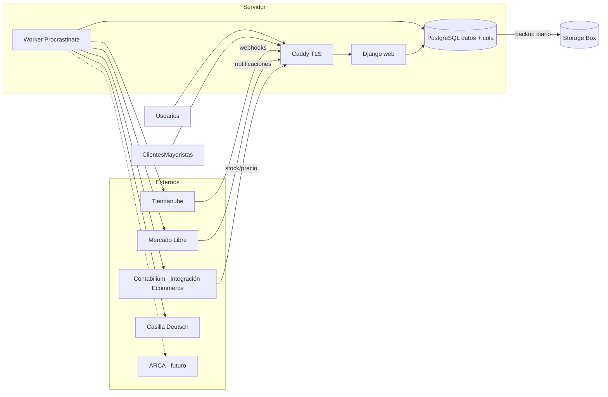

# ADR 0001 — Arquitectura base del Sistema Deutsch

- **Estado:** Aceptado (2026-11-14)
- **Tickets:** DDEV-1 (arquitectura), DDEV-2 (hosting)
- **Detalle completo:** [`specs/base-sistema/design.md`](../../specs/base-sistema/design.md)

## Contexto

Deutsch vende por Mercado Libre (~77 % de los pedidos), Tiendanube y, a futuro, una tienda mayorista propia. Hoy Contabilium es el ERP (stock, precios, facturación) y no hay acceso a su API en el plan Pro. Se necesita un centro de pedidos que centralice lo que Contabilium no tiene, con integraciones muy confiables, y que más adelante pueda reemplazar a Contabilium. El volumen es chico (< 30 pedidos/día) y todo el código lo escriben agentes de IA.

## Decisión

1. **Monolito modular Django 5.2 LTS + PostgreSQL 17**, Python 3.12 con `uv`.
2. **Cola de tareas en Postgres con Procrastinate** (sin Redis): reintentos, tareas periódicas y encolado transaccional (el evento y su tarea se guardan juntos o no se guardan).
3. **Panel con templates de Django + HTMX + Tailwind** (sin SPA, sin Node).
4. **Hosting: Hetzner** (1 VPS con producción y staging en contenedores, Caddy con TLS, backups diarios a Storage Box). ≈ USD 30/mes. **Despliegue diferido:** se desarrolla en local y en CI de GitHub hasta tener algo que mostrar en staging.
5. **Dominios:** `panel.deutsch.com.ar` (panel interno), `staging.panel.deutsch.com.ar`, `mayoristas.deutsch.com.ar` (M8).
6. **Email saliente:** casilla de Deutsch (SMTP), credenciales solo en el `.env` del servidor.
7. **Monitoreo:** Sentry (plan gratis) con enmascarado de secretos; `/health/` para monitoreo externo.

## Componentes

## Principios "preparado para ERP" (obligatorios para todos los tickets)

1. **Contabilium es un adaptador, no el centro.** Ningún módulo de negocio importa nada específico de Contabilium; todo pasa por `apps/integrations/adapters/contabilium`.
2. **Fuente de verdad configurable.** Toda escritura de stock, precio, producto, cliente o factura consulta `apps.core.sources` antes.
3. **Stock siempre por movimientos.** Solo `apps.inventory.services` modifica `StockLevel`, y siempre deja un `StockMovement`.
4. **Documentos de venta genéricos.** Pedidos, devoluciones y (futuro) facturas y notas son `SalesDocument` con `doc_type`. Nunca una tabla de pedidos por canal.
5. **IDs externos en `ExternalRef`.** Nunca columnas `tn_id` / `ml_id` en los modelos de negocio.
6. **Dinero en Decimal con moneda, precios con historial** (`PriceListItem.valid_from`).
7. **Escritura de stock/precio a canales construida pero apagada** detrás de `ensure_write_allowed` (doble llave: interruptor en el panel + `ALLOW_CHANNEL_WRITES` en el servidor).
8. **Acceso a ARCA reutilizable.** Certificado y token WSAA como credencial de un canal `arca`: hoy padrón (M8-03), mañana WSFE (F-02).

## Alternativas descartadas

| Alternativa | Por qué no |
|---|---|
| Celery + Redis | Un servicio más para operar; Postgres alcanza y da encolado transaccional. |
| Microservicios | Equipo y volumen chicos; agregan complejidad sin beneficio. |
| React/Next SPA | Dos aplicaciones y una API extra; HTMX cubre tablas, filtros y formularios. |
| Vercel | Sin procesos persistentes (worker), base y almacenamiento aparte; no encaja con un backend de integraciones. |
| Render / DigitalOcean | Funcionan, pero cuestan el doble (Render) o similar con más piezas; mudarse solo cambia `deploy/`. |
| `django-simple-history` para auditoría | Audita filas, no acciones de negocio ("quién confirmó el pago"). |

## Consecuencias

- Una sola base de datos es el único componente con estado: backups simples, restauración probada.
- Mantener el VPS (actualizaciones, Docker) queda a cargo de Kei, con scripts en `deploy/`.
- Cada módulo nuevo debe declarar permisos, auditar sus acciones de negocio y respetar los 8 principios.
