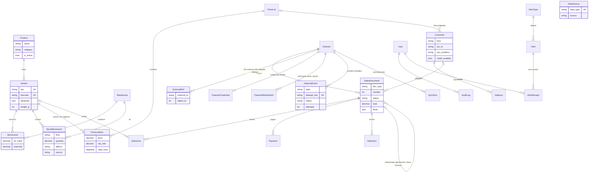

# Diagrama de entidades (núcleo M0)

Fuente: modelos en `apps/*/models.py`. Convenciones y razones en [`specs/base-sistema/design.md` §3](../specs/base-sistema/design.md).

`DataSource` (fuente de verdad por tipo de dato) no tiene relaciones: la consultan los servicios antes de escribir.
