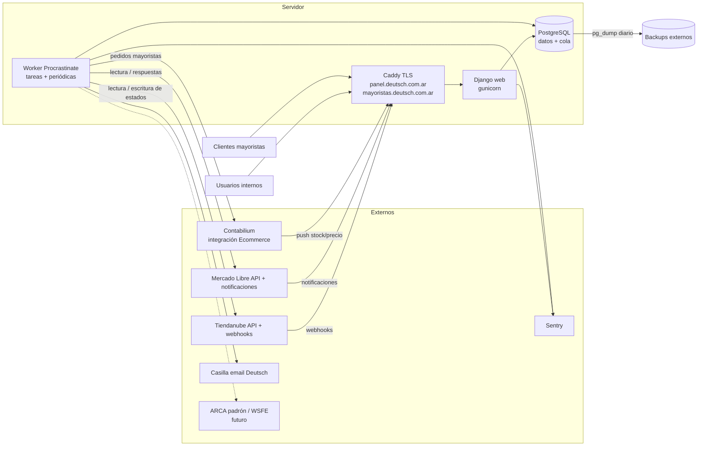
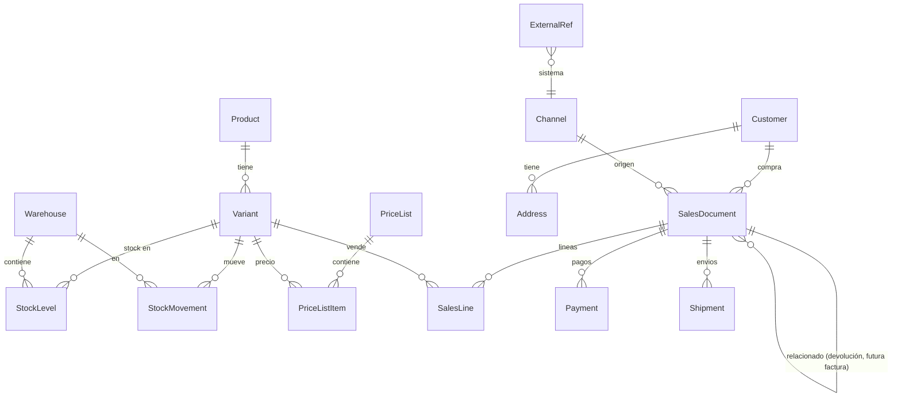

# Design: Base del sistema (módulo M0)

**Status:** Approved (2026-11-14)
**Last updated:** 2026-11-14
**Requirements:** [requirements.md](./requirements.md)

## Overview

A monolithic Django application ("modular monolith") with one Postgres database. A background worker processes tasks; it uses the same Postgres as its queue, so there is no Redis. One app with several Django modules, each with clear boundaries. The internal panel uses server-rendered pages with Django templates, HTMX and Tailwind. The wholesale store (M8) will be another set of pages in the same project, served on another domain.

The volume is small (under 30 orders a day) and the code is written by AI agents, so the design favours **few moving parts**. A single process type runs the web and another runs the worker. The database is the only stateful piece. Behaviour is covered by tests.

This document also serves as the **ADR for DDEV-1**: the decision sections are copied to `docs/adr/0001-arquitectura-base.md`. The **hosting proposal for DDEV-2** is in §8.

## 1. Stack (decisions)

| Piece | Choice | License |
|---|---|---|
| Language | Python 3.12 (managed with `uv`) | — |
| Framework | Django 5.2 LTS (support until 04/2028) | BSD |
| Database | PostgreSQL 17 | PostgreSQL |
| Task queue and scheduled jobs | **Procrastinate** (queue on Postgres, retries with backoff, periodic tasks, Django integration) | MIT |
| Panel UI | Django templates + **HTMX** + **Tailwind** (standalone CLI via `django-tailwind-cli`, no Node) | BSD/MIT |
| Configuration | `django-environ` (everything from environment variables) | MIT |
| Credential encryption | `cryptography` (Fernet), key in an environment variable | Apache/BSD |
| Tests | `pytest`, `pytest-django`, `factory-boy`, `responses` (HTTP mocks), coverage | MIT/BSD |
| Lint/format | `ruff` | MIT |
| Error monitoring | Sentry SaaS (free plan), with data scrubbing | — |
| Web server | `gunicorn` behind **Caddy** (automatic TLS) | MIT/Apache |
| Deployment | Docker image built in GitHub Actions → GHCR → `docker compose` on the server | — |

## 2. Architecture



### Repository structure

```
sistema-deutsch/
├── pyproject.toml / uv.lock
├── manage.py
├── config/                 # settings (base, local, test, prod), urls, wsgi
├── apps/
│   ├── core/               # base models, money, source of truth, utilities
│   ├── accounts/           # users, roles, permissions, login, password recovery
│   ├── audit/              # audit log
│   ├── alerts/             # alert engine (panel + email)
│   ├── catalog/            # products, variants
│   ├── inventory/          # warehouses, stock, movements
│   ├── pricing/            # price lists
│   ├── customers/          # customers with tax data
│   ├── sales/              # sales documents, lines, payments, shipments
│   └── integrations/       # framework: channels, events, credentials, switches, rate limits
│       └── adapters/       # one subpackage per channel (tiendanube, mercadolibre, contabilium) — M1/M2/M8
├── templates/  static/
├── tests/                  # mirrors apps/
├── deploy/                 # Dockerfile, compose.yml, Caddyfile, backup scripts
├── docs/adr/
└── specs/
```

Dependency rule between modules: `core` depends on nothing. Business modules depend on `core` and on whatever is "below" them: `sales` → `customers`, `catalog`, `inventory`, `pricing`. `integrations` may use every module, but no business module imports `integrations`. Other modules use `audit` and `alerts` through their service functions (`audit.record(...)`, `alerts.emit(...)`), never by writing to their tables.

### Environments

| Environment | Where | Database | Domain |
|---|---|---|---|
| local | developer's PC (Windows, no Docker): `uv run` + local Postgres 17 | `deutsch_dev` | localhost |
| test | CI and local | temporary Postgres | — |
| staging | same server as production, separate containers and database | `deutsch_staging` | `staging.panel.deutsch.com.ar` |
| production | server | `deutsch_prod` | `panel.deutsch.com.ar` (+ `mayoristas.deutsch.com.ar` in M8) |

Staging always runs with the channel write switches off and with sandbox or test credentials.

## 3. Data model (DDEV-4)

General conventions:
- PK `BigAutoField`.
- `created_at` / `updated_at` on every table.
- Money as `Decimal(14,2)` + `currency` (`ARS` by default), never `float`.
- Quantities as `Decimal(12,3)`, to support future units other than "piece".
- No hard deletes of business data: `is_active` / `archived_at`.



### catalog
```python
Product:   name, description, brand, category (str, for now), is_active
Variant:   product FK, sku (unique), barcode (null, unique), attributes JSON {"talle": "M", "color": "Negro"},
           weight_g, length_mm, width_mm, height_mm, is_active
```

### inventory
```python
Warehouse:     code (unique), name, is_default        # today one: "Local"
StockLevel:    variant FK, warehouse FK, on_hand, reserved   # unique(variant, warehouse); available = on_hand - reserved
StockMovement: variant FK, warehouse FK, quantity (+/-), kind, reference (generic: content_type+object_id null),
               source ("contabilium_sync" | "system"), note, created_by null
               kind ∈ {sync_adjustment, sale, return, reservation, release, purchase*, adjustment*, transfer*}
```
Today stock is not computed: each sync from Contabilium writes a `sync_adjustment` movement for the difference and updates `StockLevel`. The history therefore exists from day one. When the system becomes the source of truth (F-01), `StockLevel` is recomputed from its own movements (`sale`, `purchase`, …) without changing tables. Kinds marked * are for the future.

### pricing
```python
PriceList:     code (unique: "MINORISTA", "MAYORISTA"), name, currency, prices_include_vat (bool), is_active
PriceListItem: price_list FK, variant FK, price, vat_rate (Decimal, e.g. 21.00), valid_from   # unique(list, variant, valid_from)
```
Price history is kept with `valid_from`. The current price is the latest one with `valid_from <= now`.

### customers
```python
Customer: kind ("retail" | "wholesale"), legal_name, trade_name, tax_id_type ("CUIT"|"DNI"|"CF"), tax_id,
          vat_condition ("RI"|"MONOTRIBUTO"|"EXENTO"|"CF"), email, phone, price_list FK null,
          credit_enabled (bool, future current account), credit_limit null, is_active
Address:  customer FK, kind ("fiscal"|"shipping"), street, number, floor, city, province, postal_code, country="AR"
```

### sales
```python
SalesDocument: doc_type ("order" | "return" | future: "invoice", "credit_note", "debit_note"),
               channel FK, number (internal, unique per doc_type), customer FK null,
               status (str, the M4 state machine), channel_status (raw channel state),
               issued_at, currency, subtotal, discount_total, shipping_total, tax_total, total,
               related_document FK self null,
               fiscal JSON null      # future: point of sale, voucher type, CAE, due date — no columns until F-02
SalesLine:     document FK, variant FK null (null if the SKU is not in the catalog), sku_snapshot, description_snapshot,
               quantity, unit_price, discount, vat_rate, line_total
Payment:       document FK, method ("mercadopago"|"transfer"|"cash"|"current_account"|"other"), amount, status,
               paid_at, external_reference, receipt_file null
Shipment:      document FK, method ("me_flex"|"me_full"|"me_colecta"|"envio_nube"|"pickup"|"carrier"), carrier_name,
               tracking_number, status, label_file null, shipped_at
```

### integrations
```python
Channel:           code (unique: "tiendanube", "mercadolibre", "contabilium", "mayorista", "manual"), name, is_active
ExternalRef:       channel FK, content_type, object_id, external_id, extra JSON
                   # unique(channel, content_type, external_id) — one product can have IDs in TN, ML and Contabilium
ChannelCredential: channel FK (unique), data_encrypted (bytes, Fernet), expires_at null, updated_at
ChannelWriteSwitch: channel FK, kind ("stock"|"price"), enabled (bool, default False), changed_by, changed_at
                   # unique(channel, kind)
InboundEvent:      channel FK, topic, dedupe_key, payload JSON, headers JSON, received_at,
                   status ("pending"|"processing"|"done"|"failed"|"ignored"), attempts, last_error, processed_at
                   # unique(channel, dedupe_key)
SyncRun:           channel FK, job ("reconcile_orders", …), started_at, finished_at, status, stats JSON, error
RateLimitBucket:   key (unique, e.g. "mercadolibre"), capacity, refill_per_second, tokens, updated_at
```

### core: source of truth
```python
DataSource: data_type (unique: "stock"|"price"|"product"|"customer"|"invoice"), source ("contabilium"|"system"),
            changed_by, changed_at
```
Seeded by a data migration, with Contabilium as the source for all of them. `core.sources.is_owned_by_system(data_type)` is the function every editing form and every service checks. While the answer is Contabilium, the services refuse writes coming from users, with the `SourceOfTruthViolation` exception. Syncs from Contabilium are allowed.

### How it supports the future (US-4)
- **Invoicing (F-02):** an invoice is a `SalesDocument(doc_type="invoice")` related to the order, with its `fiscal` data. The lines, VAT rates and customer VAT condition already exist.
- **Current accounts (F-03):** a new `LedgerEntry` table (customer, document, debit/credit) on top of `SalesDocument` and `Payment`. Customer already has `credit_enabled` and `credit_limit`.
- **Purchases (F-04):** `Supplier` + `PurchaseDocument` mirror sales and generate `StockMovement(kind="purchase")`. The movement model already supports this.
- **Own stock (F-01):** change `DataSource("stock")` to `system` and recompute from movements.

## 4. Users, roles and permissions (DDEV-5)

- A custom user model `accounts.User` (from the start, as Django recommends) with login by **email**, plus `full_name` and `is_active`.
- **Roles = Django `Group`s:** Administrador, Depósito, Ventas, Vendedor. They are created by a data migration with their permission set.
- **Specific permissions** use `user.user_permissions` (built into Django). They add to the role's permissions. To *remove* a permission the role grants, there is a `UserPermissionDenial` model (user, permission), which a custom auth backend subtracts. This way "add or remove without changing the role" holds.
- **Business permissions** are custom permissions declared in each module, for example `sales.change_order_status`, `alerts.view_alerts` or `audit.view_auditlog`. M0 creates the ones for its own modules. Later modules declare theirs.
- **Enforcement:** each view uses a `PermissionRequiredMixin` (or a decorator) with an explicit permission. A test walks every URL in the panel and checks that **none lacks a declared permission** (except login and password recovery). Business services also check permissions, so they cannot be bypassed with HTMX.
- **Unauthorized access:** 403 with a generic page, and no data is rendered.
- **No signup:** there is no public signup URL. Users are created on panel pages under "Usuarios" (list, create, edit, deactivate, and assign role and specific permissions), visible only with `accounts.manage_users`. Creating a user sends an email to set the password, using the same reset flow. The admin never sees or sets passwords.
- **Deactivation:** `is_active=False`. Django's `ModelBackend` already rejects inactive users on every request (`get_user`), so open sessions are cut on the next request. A test covers this.
- **Recovery:** Django's `PasswordResetView`, with a token that is single-use and expires in 2 h, and texts in Spanish.
- **Django `/admin`:** only for `is_superuser` (Kei), to support the system. It is not the Deutsch panel.
- Login hardening: rate limiting of failed attempts (`django-axes`, MIT), secure cookies, CSRF.

## 5. Audit (DDEV-6)

```python
AuditLog: actor FK null (null = "sistema"), actor_label, action (str: "order.status_changed", "client.approved", …),
          content_type, object_id, object_repr, before JSON, after JSON, metadata JSON, ip, created_at
```
- Service: `audit.record(actor, action, obj, before=None, after=None, **metadata)`. Other modules call it inside the same transaction as the change.
- **Immutable:** the model overrides `save()` (only creation is allowed) and `delete()` raises an error. The admin is read-only. In addition, a migration adds a Postgres trigger that rejects `UPDATE` and `DELETE` on the table, as a second layer.
- The list of actions to audit is a catalog in `audit/actions.py`. M0 defines the full catalog from the requirement, and each module records its own actions when it is implemented.
- "Auditoría" page: a paginated table with filters for user, date range and action, visible with `audit.view_auditlog`, which only Administrador has.

## 6. Alerts (DDEV-7)

```python
AlertType:  code (unique: "integration.event_failed", "order.overdue", …), name, severity, roles M2M Group,
            send_email (bool), is_active                    # editable by the admin
Alert:      alert_type FK, title, body, link_url, dedupe_key, created_at       # unique(alert_type, dedupe_key)
AlertReceipt: alert FK, user FK, read_at null, emailed_at null, email_error  # unique(alert, user)
```
- Service: `alerts.emit(code, title, body, link_url=None, dedupe_key=...)`. It does `get_or_create` on `(alert_type, dedupe_key)`, so a repeated event creates nothing new (US-7). Next it creates a receipt for each active user in the destination roles and, if `send_email` is on, queues one `send_alert_email` task per receipt.
- Email: SMTP on Deutsch's mailbox (credentials in environment variables). The task retries up to 5 times with backoff. If it still fails, it stores `email_error`, and the alert stays visible in the panel.
- UI: a bell in the header with the unread count (refreshed by HTMX every 60 s), plus an "Avisos" page with read/unread and mark all.

## 7. Integration framework (DDEV-9)

### Inbound events

```mermaid
sequenceDiagram
    participant C as Canal (TN/ML/CB)
    participant W as Web /hooks/<canal>/
    participant DB as Postgres
    participant Q as Worker
    participant H as Handler del canal
    C->>W: POST webhook
    W->>W: verificar firma / origen (por adaptador)
    W->>DB: INSERT InboundEvent ON CONFLICT (canal, dedupe_key) DO NOTHING
    W->>DB: encolar process_event(id) (misma transacción)
    W-->>C: 200 OK (< 2 s)
    Q->>DB: SELECT ... FOR UPDATE SKIP LOCKED (status pending)
    Q->>H: handle(event)
    alt éxito
        H->>DB: upsert idempotente de la entidad + ExternalRef
        Q->>DB: status = done
    else error transitorio
        Q->>DB: attempts += 1, last_error; reintento con backoff (1m, 5m, 25m, 2h, 6h)
    else agotó reintentos
        Q->>DB: status = failed
        Q->>DB: alerts.emit("integration.event_failed", dedupe_key=event.id)
    end
```

- **Idempotency at two levels.** (1) `unique(channel, dedupe_key)` prevents storing the same event twice. Each adapter defines the key, for example the TN `event+id+updated_at` or the ML notification `_id`. (2) Handlers do *upserts* keyed by `ExternalRef`, so processing the same entity twice produces the same result. Tests cover both levels.
- **Interface for each adapter** (implemented in M1, M2 and M8):
  ```python
  class ChannelAdapter(Protocol):
      code: str

      def verify_webhook(self, request) -> bool: ...
      def dedupe_key(self, payload: dict, headers: dict) -> str: ...
      def topic(self, payload: dict, headers: dict) -> str: ...

      handlers: dict[str, Callable[[InboundEvent], None]]  # by topic

      def reconcile(self, since: datetime) -> SyncStats: ...  # periodic task
  ```
  Adapters register themselves in `integrations.registry`. M0 ships a `fake` adapter, used only in tests, that exercises the whole flow.
- **Manual reprocessing:** a button on the integrations panel that sets `failed` events back to `pending` (permission `integrations.retry_event`, audited).
- **Reconciliation:** a Procrastinate periodic task per channel (for example every 15 min) calls `adapter.reconcile(since=last successful run - margin)` and records a `SyncRun`. What it finds goes through the same idempotent upsert.

### Outbound HTTP client
`integrations.http.ChannelClient(channel)` wraps `httpx` with timeouts, retries on 429 and 5xx with backoff, and the **rate limit**. The rate limit is a token bucket in `RateLimitBucket`, updated with `SELECT … FOR UPDATE` (correct even with several workers), and its capacity is configurable per channel. The client also logs requests without headers or tokens: a list of sensitive keys is masked before logging.

### Credentials
`ChannelCredential.data_encrypted` = Fernet(JSON). The key comes from `FIELD_ENCRYPTION_KEY` (env) and supports rotation with `MultiFernet`. Access goes only through `credentials.get(channel)` and `credentials.save(channel, data)`. The model's `__repr__` and the admin never show the value. A test checks that a fake token never appears in the logs captured during a full flow.

### Write switch (golden rule)
```python
def ensure_write_allowed(channel_code: str, kind: Literal["stock", "price"]) -> None:
    # Reads ChannelWriteSwitch; if it does not exist or enabled=False → logs a WARNING + AuditLog "integration.write_blocked"
    # and raises WriteBlocked. Called on the first line of every adapter's write_stock()/write_price().
```
- Default value: off for every channel (data migration).
- Turning a switch on requires the `integrations.toggle_write_switch` permission (Administrador only) **and** the `ALLOW_CHANNEL_WRITES=true` environment variable on the server. There are two locks: one in the database and one in the deployment. Every change is audited.
- Test: with the switch off, `write_stock` raises `WriteBlocked` and makes no HTTP request (checked with `responses`).

## 8. Hosting (DDEV-2)

Requirements: production + staging, Postgres with automatic backups, worker, file storage (receipts, labels) and outbound email. Email uses Deutsch's mailbox, so it adds no cost. Approximate prices for November 2026, before VAT. The rate used is the card dollar at about ARS 2,040 per USD. **Check prices when signing up**: Hetzner raised prices in June 2026.

| | A. Hetzner VPS (recommended) | B. Render (managed PaaS) | C. DigitalOcean (droplet + managed DB) |
|---|---|---|---|
| Composition | 1 VPS, 2 vCPU / 4 GB (CPX22 or CX23 if available), prod + staging in containers; Postgres in a container; Caddy | Web Starter + Worker Starter + Postgres Basic-1GB (prod) + small web and DB (staging) | Droplet 2 GB (prod+staging) + Managed Postgres 1 GB |
| Monthly cost | ≈ €20 VPS + €4 snapshots + €3.2 Storage Box (offsite backups) ≈ **USD 30 / ARS 61,000** | ≈ USD 7+7+19 (prod) + 7+6 (staging) + workspace ≈ **USD 50–75 / ARS 102,000–153,000** | ≈ USD 12 + 15 + backups 2.4 ≈ **USD 30–35 / ARS 61,000–71,000** |
| Backups | nightly `pg_dump` → Storage Box (30 days) + weekly VPS snapshot | included in managed Postgres (point-in-time recovery on paid plans) | DB: daily included; droplet: +20% |
| Operations | we maintain the OS, Docker and updates (scripted) | nothing to maintain | DB managed; droplet maintained by us |
| Persistent disk for files | the VPS disk itself (+ copy to Storage Box) | needs paid persistent disk or S3 | droplet disk or Spaces (USD 5) |
| Latency from AR | ~150 ms (US-East Ashburn location) | ~150 ms (Ohio/Virginia) | ~150 ms (NYC) |

**Deferred deployment (decision 2026-11-14):** Hetzner has no free plan. Development and testing happen first locally and in GitHub's CI (free). The server is rented once there is something to show in staging. Until then, the deployment pieces (Dockerfile, compose, workflows) are prepared but not run.

**Recommendation: A, Hetzner.** It is the cheapest option that meets backups and staging. At this volume, one VPS has plenty of capacity. The operations cost is low because deployment is `docker compose` with scripts the agent maintains. Moving to B or C later means changing only `deploy/`, because the app reads everything from environment variables. **Kei must approve** this choice; after approval it is recorded in the ADR.

## 9. Backups and monitoring (DDEV-8)

- `deploy/backup.sh` (cron on the server, 03:00 ART): `pg_dump -Fc` of prod and staging → compressed and encrypted (`age`) → Storage Box over SFTP, kept for 30 days. Uploaded files (`media/`) are synced with `rsync`.
- `deploy/restore.sh` restores a dump into a temporary database and runs a check (row counts for the main tables). The first restore drill is documented in `docs/runbooks/restore.md`.
- If the backup fails, the script calls `manage.py emit_alert backup.failed`, which emails Administradores and Kei.
- Sentry: `sentry-sdk` with `send_default_pii=False` and a `before_send` hook that masks the keys `token`, `authorization`, `password`, `secret`, `access_token`, `refresh_token`, `cbu` and `card`. Environment tag: staging or prod.
- **Integrations panel** (`integrations.view_status` permission) shows one card per channel with:
  - last successful `SyncRun` and its age (red if more than 1 h for TN/ML);
  - events `pending`, `failed` and done in the last 24 h;
  - the last 10 errors;
  - write switch status;
  - token expiry.
- Health check `/health/` (DB + last worker heartbeat) for external monitoring (UptimeRobot free).

## 10. CI/CD (DDEV-3)

- Private GitHub repo `sistema-deutsch` (account to be confirmed: Kei's or the user's).
- `ci.yml` workflow on every push and PR, which runs:
  - `ruff check`;
  - `ruff format --check`;
  - `pytest` against a Postgres 17 service;
  - `manage.py makemigrations --check`;
  - `manage.py check --deploy` with production settings.
- `deploy-staging.yml`, on push to `main` when CI passes: builds the image → pushes to GHCR → SSHes to the server → `docker compose -p staging pull && up -d` → runs migrations → smoke test on `/health/`.
- `deploy-prod.yml`, triggered **manually** (`workflow_dispatch`) with a GitHub environment that requires approval: it takes the staging image tag (the same image, rebuilt from nothing) and deploys it to the prod stack.
- Secrets: GitHub Actions secrets (SSH key, etc.) and an `.env` file on the server with `chmod 600`, outside the repo. The repo includes `.env.example` without values.
- Local, without Docker: `uv sync`, then `createdb deutsch_dev`, then `uv run manage.py migrate`, then `uv run manage.py runserver`, and `uv run manage.py procrastinate worker` in another terminal. All of this is in the README.

## 11. Trade-offs and alternatives considered

| Decision | Chosen | Alternative | Why not |
|---|---|---|---|
| Task queue | Procrastinate (Postgres) | Celery + Redis | Redis is one more service to run, back up and monitor. At <30 orders/day Postgres is plenty, and it gives transactional enqueueing (event and task are saved together or not at all). Locally it needs only Postgres. |
| | | Django 6 Tasks | The framework exists, but without a production worker backend in core. |
| Architecture | Modular monolith | Microservices | Small team and volume; microservices add deployment, network and consistency problems without benefit. |
| Panel UI | Django templates + HTMX | React/Next SPA | One language, no separate API, less code for agents to maintain. Tables, filters and forms work very well with HTMX. If the wholesale store needs more interactivity (the size × color grid), small islands of Alpine.js are enough. |
| Users/roles | Groups + permissions + denials | Third-party RBAC library | Django already solves 90%. The only addition is "remove a permission", with one table and one backend. |
| Audit | Own `AuditLog` with explicit domain actions | `django-simple-history` / `pghistory` | Those audit tables, not business actions. The requirement asks for "who confirmed the payment", not "which field of which row changed". An immutability trigger is added. |
| Stock | Movements from day one (`sync_adjustment`) | Only store the current value | The movement history is what lets the system take over stock without migrating (ERP principle). |
| Prices | `PriceListItem` with `valid_from` | Price on the variant | The future needs several lists and history (orders frozen at the price of the moment). |
| Hosting | Hetzner VPS | Render / DigitalOcean | See §8: cost about half, with enough capacity. |
| Login | Email + password + axes | 2FA from the start | Possible later with `django-otp`; not requested. |

## 12. "Preparado para ERP" principles (to be respected by every ticket)

1. **Contabilium is an adapter, not the center.** No business module imports anything Contabilium-specific; everything goes through `integrations/adapters/contabilium`.
2. **Configurable source of truth.** Every write of stock, price, product, customer or invoice checks `core.sources` first.
3. **Stock always through movements.** No code updates `StockLevel` directly outside `inventory.services`, which writes the movement.
4. **Generic sales documents.** Orders, returns and (in future) invoices and credit notes are `SalesDocument` with `doc_type`. Never a separate per-channel order table.
5. **External IDs in `ExternalRef`.** Never a `tn_id` or `ml_id` column on business models.
6. **Money in Decimal with currency, and prices with history.**
7. **Writing stock and prices to channels is built but switched off,** behind `ensure_write_allowed`.
8. **Reusable ARCA access.** The WSAA certificate and token are stored as a credential of an `arca` channel, used today for the padrón (M8-03) and tomorrow for WSFE (F-02).

## 13. Requirement traceability

| Requirement | Where |
|---|---|
| US-1 ADR, components diagram, ERP principles | §1, §2, §12 → `docs/adr/0001` + Plane |
| US-2 hosting options with costs, backups, staging, decision recorded | §8 (decision pending Kei's approval) |
| US-3 README, CI with tests, automatic staging, manual prod, secrets outside code | §10, §2 Environments |
| US-4 entities, configurable source of truth, read-only while Contabilium, migrations with tests, ERD, future | §3 |
| US-5 roles, manual creation, add/remove permissions, 403 without data, no signup, recovery, deactivation | §4 |
| US-6 common mechanism, fields, immutable, filtered screen for admins | §5 |
| US-7 read/unread panel, emails by role, deduplication, email retries | §6 |
| US-8 daily backup + restore drill, Sentry without secrets, integrations panel | §9 |
| US-9 response <2 s + queue, idempotency, retries + alert + reprocessing, reconciliation, encrypted credentials, rate limit, switch | §7 |

## Open questions / risks

- **GitHub account** where the repo will live (Kei's organization or a personal account). This does not block local development; it is needed for CI (DDEV-3).
- **Deutsch's SMTP mailbox data** (server, port, user, password). They go in the server's `.env`, never in Plane or chat. Until we have them, the console or a test SMTP is used.
- **DNS for `panel.deutsch.com.ar`:** whoever manages the deutsch.com.ar domain must create A records pointing to the server.
- **Hetzner availability** of the CX23 and prices after the June 2026 increase: check when signing up.
- **Risk:** prod and staging on the same VPS. A badly configured staging could consume resources. Mitigation: memory limits per container. If it becomes a problem, staging moves to a separate CX23 (~€6).
