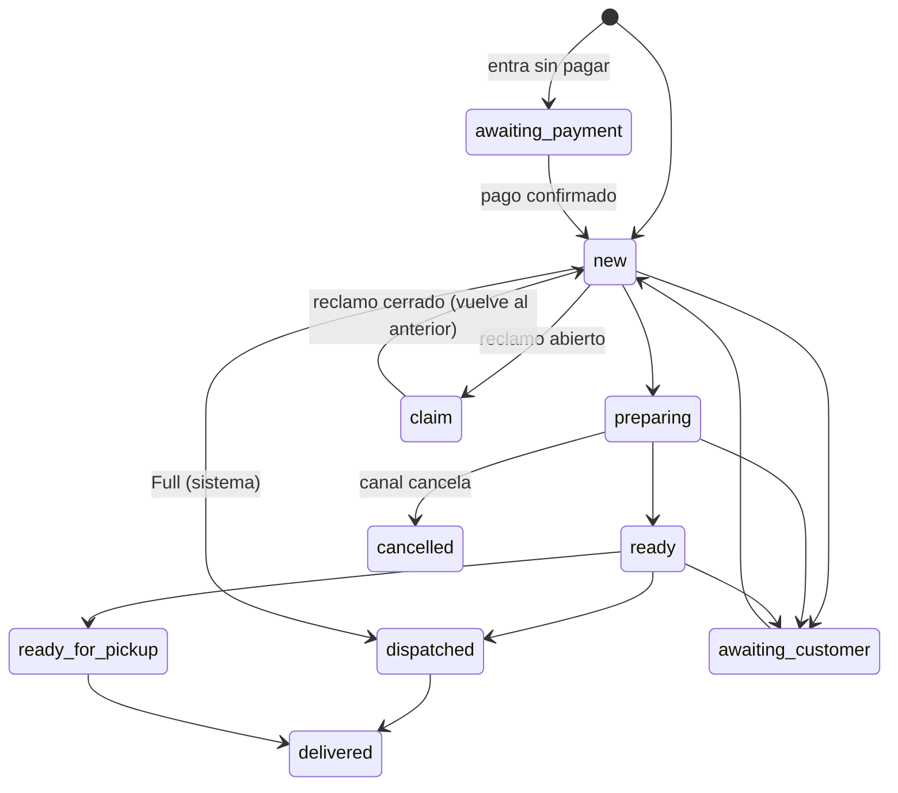

# Design: Centro de pedidos (módulo M4)

**Status:** Approved (2026-11-14)
**Last updated:** 2026-11-14
**Requirements:** [requirements.md](./requirements.md)

## Overview

Todo vive en la app `sales`, sobre el `SalesDocument` que ya llenan M1 (Tiendanube) y M2 (Mercado Libre). M4 agrega:

1. **Máquina de estados** (`sales/states.py`): estados, transiciones permitidas y un único servicio `change_status()` que valida, audita y dispara efectos (marcar en Tiendanube y alertas).
2. **Sincronización automática** (`sales/sync.py`): `sync_internal_status(doc)` lee hechos genéricos del documento (pagos, envíos, estado crudo del canal, reclamos) y aplica las transiciones de "sistema". Los adaptadores la llaman al final de cada upsert. No hay lógica de estados dentro de los adaptadores.
3. **Pedidos manuales** (`sales/manual.py`), **devoluciones** (`sales/returns.py`) y **alertas de pedidos** (`sales/tasks.py`).
4. **Pantallas** bajo `/pedidos/`.

## 1. Estados y transiciones (US-2)

| Código | Estado | Tipo |
|---|---|---|
| `new` | Nuevo | flujo |
| `preparing` | En preparación | flujo |
| `ready` | Listo | flujo |
| `dispatched` | Despachado | flujo |
| `ready_for_pickup` | Listo para retirar | flujo |
| `delivered` | Entregado | final |
| `cancelled` | Cancelado | final |
| `claim` | Con reclamo | especial |
| `awaiting_payment` | Esperando pago | especial |
| `awaiting_customer` | Esperando cliente | especial |

**Transiciones manuales** (`TRANSITIONS`, origen → destinos permitidos):

```
new               → preparing, awaiting_customer, cancelled*
preparing         → ready, new, awaiting_customer, cancelled*
ready             → dispatched, ready_for_pickup, preparing, awaiting_customer, cancelled*
dispatched        → delivered
ready_for_pickup  → delivered, ready
awaiting_customer → new, preparing, ready, cancelled*
awaiting_payment  → new, cancelled*
claim             → (estado anterior al reclamo)          # salida manual solo si el reclamo ya no está abierto
delivered, cancelled → (ninguna)
```
- `*` Cancelar a mano solo se permite en **pedidos manuales** y requiere `sales.cancel_manual_order`. Los pedidos de TN y ML se cancelan en el canal, y el sistema lo refleja solo.
- `ready_for_pickup` solo se ofrece si el envío es de retiro, y `dispatched` solo si no lo es.



**Servicio único:**
```python
def change_status(doc, to: str, *, user=None, reason: str = "", tracking_code="", tracking_url="",
                  system=False, request=None) -> None
```
1. Valida: si `system=False`, la transición tiene que estar en `TRANSITIONS`, el usuario necesita el permiso y, para cancelar, que sea un pedido manual. Si `system=True`, se usa la tabla de reglas de §2. Si no pasa, lanza `TransitionNotAllowed` con un mensaje legible.
2. Bloquea la fila (`select_for_update`), guarda `status`, `status_changed_at` y, si entra a `claim`, `status_before_claim`.
3. Audita `order.status_changed` con `{from, to, reason}`. El actor es el usuario, o "sistema" si `system=True`.
4. Efectos en `on_commit`:
   - **Tiendanube:** si el pedido es de TN y lo cambió un usuario (no el sistema):

     | Nuevo estado | Se llama a |
     |---|---|
     | `ready` | `mark_packed` |
     | `dispatched` | `mark_dispatched` (con el seguimiento) |
     | `ready_for_pickup` | `mark_dispatched` (M1 lo traduce a "listo para retirar") |
     | `delivered` | `mark_delivered` |

   - **Alerta de cancelación:** si el pedido pasa a `cancelled` desde `preparing` o `ready`, se emite `orders.cancelled_in_progress`.

## 2. Sincronización con los canales (US-2)

`sync_internal_status(doc, *, created: bool)` se llama al final de:
- `tiendanube.orders.upsert_order`;
- `mercadolibre.orders.upsert_order` y `mercadolibre.shipments.refresh`;
- `mercadolibre.claims.upsert_claim` (para el documento del reclamo).

**Hechos genéricos** (`facts(doc)`, sin código por canal):

| Hecho | Cómo se calcula |
|---|---|
| `cancelled` | `channel_status` empieza con `cancelled` (TN `cancelled/…`; en ML, todas las órdenes del pack canceladas) |
| `paid` | suma de pagos `confirmed` ≥ total, o total = 0 |
| `delivered` | algún envío con `status == "delivered"`, o en TN `shipping_status` = `delivered` (último segmento de `channel_status`) |
| `full` | algún envío con `method == me_full` |
| `claim_open` | algún `Claim` del documento con `status == "opened"` |

**Reglas, en orden** (la primera que aplica gana; todas con `system=True` y un motivo legible):

1. `cancelled` y estado distinto de `delivered`/`cancelled` → `cancelled` ("Cancelado en {canal}").
2. `delivered` y estado distinto de `delivered`/`cancelled` → `delivered` ("Entregado según {canal}").
3. `claim_open` y estado distinto de `claim`/`cancelled` → `claim` (guarda el anterior).
4. No `claim_open` y estado `claim` → `status_before_claim` ("Reclamo cerrado").
5. `full` y estado en {`new`, `awaiting_payment`, `preparing`, `ready`} → `dispatched` ("Full: despacha Mercado Libre").
6. Al crear: si no `paid` → `awaiting_payment`. Si está `paid` y no es Full → queda `new` y se emite `orders.new`.
7. Estado `awaiting_payment` y `paid` → `new` ("Pago confirmado") y se emite `orders.new`.

- **Idempotente:** si nada cambia, no escribe ni audita. Correr la sincronización dos veces da el mismo resultado.
- **Sin bucles con TN:** las transiciones del sistema nunca disparan escrituras a Tiendanube (paso 4 de §1).
- **Al crear** también se chequea el stock (§6).

## 3. Cambios de modelo

```python
# sales.SalesDocument
status                = CharField(choices=Status.choices, default="new", db_index=True)   # ya existía (texto libre)
status_before_claim   = CharField(blank=True)
status_changed_at     = DateTimeField(null=True)
channel_reference     = CharField(max_length=60, blank=True, db_index=True)  # "TN #1234", "ML pack 777", "Manual #12"
invoiced_in_contabilium = BooleanField(default=False)
invoice_number        = CharField(blank=True)
invoiced_at           = DateTimeField(null=True)

# sales.SalesLine
condition             = CharField(blank=True, choices=[("", "—"), ("resellable", "Apto para reventa"), ("damaged", "Dañado")])
                        # solo en documentos de devolución

# sales.Shipment.Method: + OTHER ("other", "Otro")

# sales.ReturnInfo (nuevo, uno a uno con el SalesDocument de tipo "return")
ReturnInfo: document 1:1, source ("ml_claim"|"manual"), claim FK conversations.Claim null,
            expected_at, received_at null, received_by FK null, comment,
            adjusted_in_contabilium bool, adjusted_by FK null, adjusted_at null
```
- M1 y M2 completan `channel_reference` en sus upserts: TN `TN #{number}`; ML `ML pack {id}` o `ML {order_id}`. Una migración de datos lo completa para los documentos existentes.
- Los manuales usan `Manual #{number}`.
- **Permisos** (en `sales`):

  | Permiso | Roles |
  |---|---|
  | `view_salesdocument` | todos |
  | `change_order_status` | Depósito, Ventas, Administrador |
  | `cancel_manual_order` | Ventas, Administrador |
  | `add_manual_order` | Ventas, Administrador |
  | `receive_return` | Depósito, Ventas, Administrador |
  | `mark_return_adjusted` | Administrador |

- **Acciones de auditoría nuevas:** `order.payment_updated`, `order.invoice_updated`, `return.received`, `return.adjusted`, `return.expected_created`. Ya existen `order.status_changed` y `order.manual_created`.

## 4. Pedidos manuales (US-3)

`sales/manual.py`:
```python
def create_manual_order(*, customer, lines: list[ManualLine], delivery: str, address: dict | None,
                        notes: str, paid: bool, payment_method: str, invoiced: bool, invoice_number: str,
                        user, request=None) -> SalesDocument
```
- **Mayorista:** si `customer.kind == wholesale`, lanza `WholesaleNotAllowed` ("Los pedidos mayoristas se cargan desde la tienda mayorista").
- **Documento:**
  - canal `manual`, estado `new`, líneas del catálogo con `sku_snapshot` y `description_snapshot`;
  - precio de referencia: el minorista vigente si no se edita;
  - totales recalculados.
- **Pago:** un `Payment` con el medio elegido y estado `confirmed` (cobrado) o `pending`. El envío es un `Shipment` con el método (`pickup`, `carrier` u `other`) y el domicilio.
- **Auditoría:** `order.manual_created`. Se emite `orders.new` para Depósito.
- **Cliente:** `find_or_create_customer(form)` busca por documento y después por email, y si no encuentra crea un cliente minorista. Un cliente existente se elige con un buscador HTMX.
- **Edición posterior:**
  - `update_payment(doc, paid, method, user)` audita `order.payment_updated`;
  - `update_invoice(doc, invoiced, number, user)` audita `order.invoice_updated`;
  - las dos con `sales.add_manual_order`.

## 5. Devoluciones (US-4)

`sales/returns.py`:
```python
def ensure_expected_for_claim(claim) -> SalesDocument | None
    # Se llama desde ML claims.upsert_claim cuando return_status no está vacío: crea, si no existe,
    # un SalesDocument(doc_type=return, related_document=pedido, status="expected") + ReturnInfo(source=ml_claim)
    # con las líneas del pedido como esperadas.
def create_expected(order, lines, *, user) -> SalesDocument      # manual (TN o manual), audita return.expected_created
def receive(return_doc, received: list[(line, qty, condition)], comment, *, user) -> None
    # pone cantidades y condición, ReturnInfo.received_at/by, estado "received", audita return.received
    # y emite la alerta returns.received_adjust_stock (dedupe por devolución)
def receive_unexpected(order, received, comment, *, user) -> SalesDocument   # crea y recibe en un paso
def mark_adjusted(return_doc, *, user) -> None                   # audita return.adjusted
```
- **Estados del documento de devolución:** `expected` → `received`. El campo `status` del `SalesDocument` es compartido, pero los estados de devolución son otros valores válidos solo para `doc_type=return`, y la máquina de §1 se aplica solo a pedidos.
- **No toca stock:** el stock del sistema refleja Contabilium, y el ajuste se hace allá. Por eso existen la alerta y la marca "ajustado".

## 6. Alertas (US-5)

**Tipos nuevos** (migración de datos, editables por el admin):

| Código | Para | Email | Cuándo |
|---|---|---|---|
| `orders.new` | Depósito | no | Pedido pasa a `new` para preparar |
| `orders.flex_due` | Depósito | sí | Flex o Colecta no despachado a menos de `ORDERS_FLEX_WARNING_MINUTES` (120) del límite |
| `orders.cancelled_in_progress` | Administrador | sí | Cancelado estando en preparación o listo |
| `orders.out_of_stock` | Administrador | sí | Al entrar una venta: alguna línea sin stock en el depósito (ver abajo) |
| `orders.manual_pending` | Administrador, Ventas | sí | Manual con más de `ORDERS_MANUAL_PENDING_HOURS` (24) sin cobrar o sin facturar |
| `returns.received_adjust_stock` | Administrador | sí | Devolución recibida, para ajustar el stock en Contabilium |

- **"Sin stock en el depósito":** al crear un pedido TN/ML no Full, alguna línea con variante cuyo `StockLevel` disponible (`on_hand − reserved`) es menor a 0, o que no tiene stock registrado. También líneas sin variante (SKU desconocido, que ya alerta M1/M2). El stock del sistema es espejo de Contabilium/Tiendanube y ya descuenta la venta, así que un disponible negativo indica que se vendió de más. Esta regla se ajusta con datos reales si genera ruido.
- **Tarea periódica** `orders_watch` cada 10 min:
  - Flex/Colecta por vencer (dedupe por envío);
  - manuales pendientes (dedupe por documento y motivo: `pago` o `factura`).
- Las demás alertas se emiten en el momento, desde `change_status` o `sync_internal_status`.

## 7. Pantallas (US-1, US-3, US-4)

| URL | Qué | Permiso |
|---|---|---|
| `/pedidos/` | Lista con filtros: canal, estado (multi), desde/hasta, comprador, SKU, cobro. Paginada de a 50; orden por fecha límite y después fecha. Tabla en escritorio, tarjetas en celular | `view_salesdocument` |
| `/pedidos/<id>/` | Ficha con las secciones de US-1 y botones grandes con las transiciones permitidas (form POST, con un campo de seguimiento al despachar TN) | `view_salesdocument` (acciones según permiso) |
| `/pedidos/<id>/estado/` (POST) | `change_status` | `change_order_status` |
| `/pedidos/nuevo/` | Alta manual: cliente (buscador o nuevo), líneas con buscador de SKU por HTMX, entrega, cobro, facturación | `add_manual_order` |
| `/pedidos/<id>/cobro/` y `/pedidos/<id>/factura/` (POST) | Edición de un pedido manual | `add_manual_order` |
| `/pedidos/devoluciones/` | Pestañas "Esperadas" y "Recibidas", con la marca de "Ajustado en Contabilium" | `receive_return` |
| `/pedidos/devoluciones/<id>/recibir/` | Formulario por línea: cantidad y condición, más comentario | `receive_return` |
| `/pedidos/<id>/devolucion-esperada/` (POST) | Cargar una devolución esperada (TN o manual) o recibir una no esperada | `receive_return` |
| `/pedidos/devoluciones/<id>/ajustado/` (POST) | Marcar como ajustado | `mark_return_adjusted` |

- **Lista sin N+1:**
  - `select_related(channel, customer)`;
  - se anotan la fecha límite mínima (`Min(shipments__dispatch_deadline)`), el método del primer envío y lo cobrado (`Sum` de pagos confirmados);
  - `prefetch_related(lines)` limitado a la página;
  - un test de cantidad de consultas.
- **Celular:** grid de tarjetas en pantallas angostas, con estado, canal, comprador, total, fecha límite y botón "Ver".
- **Badges de estado:** un color por familia (flujo, especial, final) y la fecha límite en rojo si faltan menos de 2 h.
- **Menú:** "Pedidos" y "Devoluciones" según permisos, y "Nuevo pedido" dentro de Pedidos.

## 8. Trade-offs

| Decisión | Elegido | Alternativa | Por qué |
|---|---|---|---|
| Dónde vive la lógica de estado | Servicio único `change_status` + `sync_internal_status` genérico | Cada adaptador decide su estado interno | Un solo lugar con reglas y auditoría; los canales solo informan hechos |
| Hechos del canal | Derivados de pagos, envíos, `channel_status` y reclamos | Campos nuevos por canal | No suma columnas por canal (principio ERP 5) y reusa lo que M1 y M2 ya guardan |
| Cancelar pedidos de canal | Solo desde el canal | Permitir cancelar en el sistema | Cancelar solo acá desincroniza con el canal y con Contabilium |
| Devoluciones | `SalesDocument` tipo devolución + `ReturnInfo` | Tabla de devoluciones aparte | El documento de devolución es la base de la futura nota de crédito (ERP) |
| Librería de máquina de estados | Diccionario de transiciones propio | `django-fsm` | Son 10 estados; una tabla explícita es más clara y fácil de testear |

## 9. Tests

- **Estados:**
  - cada transición permitida;
  - transiciones prohibidas;
  - permisos por rol;
  - cancelar: manual sí, de canal no;
  - despachar vs. listo para retirar según el envío;
  - auditoría con desde, hasta y motivo;
  - escritura a TN por cada estado con `respx` (el sistema no escribe);
  - alerta de cancelación en preparación.
- **Sincronización:**
  - Full → despachado;
  - cancelado en TN y en ML (pack completo);
  - entregado;
  - sin pagar → esperando pago → pago → nuevo;
  - reclamo abierto y cerrado vuelve al anterior;
  - idempotente (sin auditorías extra);
  - no pisa entregado ni cancelado;
  - integración con los upserts reales de M1 y M2.
- **Manual:** creación completa, mayorista rechazado, precio de referencia por defecto, cobro y factura editables, permisos, alerta de pendiente después de 24 h (con fecha simulada).
- **Devoluciones:**
  - esperada creada desde el reclamo de ML (una sola vez);
  - esperada manual;
  - recibir con condición;
  - recibir no esperada;
  - alerta;
  - marcar ajustado (solo admin);
  - no toca stock.
- **Alertas:** Flex por vencer (una vez por envío), pedido nuevo solo en el panel, sin stock.
- **Pantallas:**
  - cada filtro;
  - orden;
  - ficha con todas las secciones;
  - botones según permisos y estado;
  - cantidad de consultas de la lista;
  - vista de celular (render de tarjetas).

## 10. Trazabilidad

| Requirement | Dónde |
|---|---|
| US-1 lista, filtros, orden, ficha, celular | §7 |
| US-2 estados, transiciones, permisos, Full, cancelación, entrega, pago, reclamo, auditoría, TN, no escribir en ML | §1, §2, §3 |
| US-3 alta, cobro, factura, mayorista, edición, permisos | §3, §4, §7 |
| US-4 esperadas/recibidas, condición, documento de devolución, alerta, ajustado, no esperadas | §3, §5, §7 |
| US-5 Flex, nuevos, cancelaciones, sin stock, manuales pendientes, motor M0 | §6 |

## Riesgos

- **"Sin stock en el depósito":** la regla depende de cómo se refleje el stock real (espejo de TN o Contabilium). Se revisa con datos reales y puede ajustarse para evitar ruido.
- **Estados de entrega de TN:** el valor exacto de `shipping_status` para "entregado" se confirma en la prueba real. La regla acepta `delivered`.
