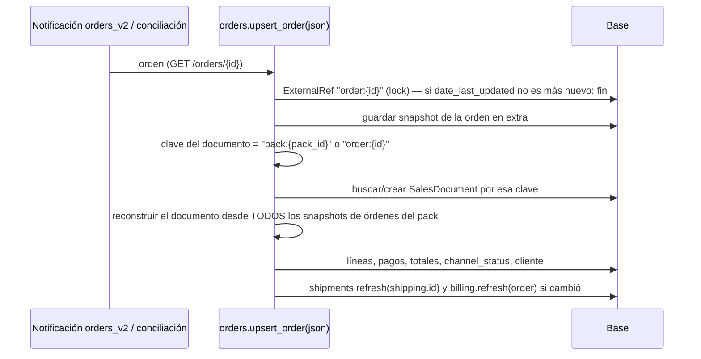

# Design: Integración Mercado Libre (módulo M2)

**Status:** Approved (2026-11-14)
**Last updated:** 2026-11-14
**Requirements:** [requirements.md](./requirements.md)

## Overview

Un adaptador `apps/integrations/adapters/mercadolibre/` con el mismo patrón que Tiendanube:
- Cada notificación significa "volvé a leer este recurso". El upsert es idempotente y controla la frescura.
- Las conciliaciones periódicas pasan por el mismo upsert. Sin servidor, son la vía principal de entrada (cada 5 min).

Mercado Libre agrega cuatro cosas que Tiendanube no tiene, y por eso el diseño suma:
1. **Token que vence cada ~6 h**, con refresh token de un solo uso. La renovación tiene que ser atómica.
2. **Packs:** un carrito con varios productos son varias órdenes de ML que forman un solo pedido.
3. **Publicaciones con estado propio** (título, tipo, salud, Full), que no son solo "variantes": nuevo modelo genérico `Listing`.
4. **Preguntas, mensajes y reclamos:** nueva app genérica `conversations`, con un modelo por tipo y canal como FK, sin tablas "de ML".

Base de la API: `https://api.mercadolibre.com`, sitio `MLA`.

## 1. Componentes

```
apps/integrations/adapters/mercadolibre/
├── __init__.py       # registra el adaptador y sus tareas
├── adapter.py        # MercadoLibreAdapter: verify (app/vendedor), topic, dedupe, handlers por tópico
├── auth.py           # OAuth (URL, canje, pegar URL de vuelta), renovación atómica, token vigente
├── client.py         # MLClient: Bearer, reintento único ante 401 con renovación, paginación (offset y scan)
├── listings.py       # publicaciones → Listing / ListingVariation + vínculo a Variant por SKU
├── orders.py         # órdenes → pack → SalesDocument (+ cliente, líneas, pagos)
├── shipments.py      # envíos: modalidad, plazo de despacho, estado, etiquetas PDF/ZPL
├── billing.py        # datos fiscales del comprador → Customer
├── questions.py      # preguntas: guardar, conciliar, responder
├── messages.py       # mensajes postventa: guardar, conciliar, enviar
├── claims.py         # reclamos y devoluciones
├── tasks.py          # renovación, conciliaciones periódicas, importaciones
├── views.py / urls.py  # conectar, callback, pegar URL, importar
apps/conversations/   # NUEVA app genérica: Question, Message, Claim
```

```mermaid
graph LR
    ML[API Mercado Libre] -- notificaciones --> HOOK[/hooks/mercadolibre/ (M0)/]
    HOOK --> Q[(Cola)] --> AD[MercadoLibreAdapter]
    AD --> LI[listings] & OR[orders] & SH[shipments] & QU[questions] & ME[messages] & CL[claims]
    OR --> BI[billing]
    LI & OR & SH & QU & ME & CL & BI --> CLI[MLClient] --> AUTH[auth: token vigente] --> ML
    TASKS[tareas periódicas] --> LI & OR & SH & QU & ME & CL
    TASKS --> AUTH
```

## 2. Configuración

| Variable | Uso |
|---|---|
| `ML_APP_ID`, `ML_CLIENT_SECRET` | App en Mercado Libre Developers |
| `ML_REDIRECT_URI` | URL de vuelta registrada en la app, ver §3 |
| `ML_SITE` | `MLA` |
| `ML_POLL_MINUTES` | 5: conciliación de ventas, preguntas y mensajes |
| `ML_LABEL_FORMAT` | `pdf` o `zpl2`. Por defecto `pdf` hasta confirmar la impresora |

Credencial cifrada (M0): `{access_token, refresh_token, expires_at, user_id, scope}`.

## 3. Conexión y token (US-1)

**Autorización:**
1. El admin toca **Conectar Mercado Libre**. El sistema genera un `state`, lo guarda en la sesión y redirige a `https://auth.mercadolibre.com.ar/authorization?response_type=code&client_id={ML_APP_ID}&redirect_uri={ML_REDIRECT_URI}&state={state}`.
2. El dueño de la cuenta de Deutsch inicia sesión y autoriza.
3. ML vuelve a `ML_REDIRECT_URI?code=…&state=…`. Hay dos caminos según dónde apunte esa URL:
   - **Con servidor:** apunta a `https://panel.deutsch.com.ar/integraciones/mercadolibre/callback/` y el sistema completa todo solo.
   - **Sin servidor:** ML solo acepta URLs `https`, así que `localhost` no sirve. La app se registra con una URL `https` cualquiera que controle Kei, y el admin **pega en el panel la URL completa** a la que volvió el navegador. El sistema extrae `code` y `state`, valida el `state` y sigue igual que el callback.
4. Canje del código: `POST https://api.mercadolibre.com/oauth/token`, `grant_type=authorization_code` (form). La respuesta trae `access_token`, `refresh_token`, `expires_in` (~21600 s), `user_id` y `scope`. Se guarda cifrado, se audita `integration.connected` y se encolan las importaciones iniciales (publicaciones y ventas de 30 días).

**Renovación atómica:**
```python
def get_access_token() -> str:
    # 1) leer la credencial; si vence en más de 30 min → devolver el token
    # 2) si no: transaction + SELECT … FOR UPDATE sobre ChannelCredential (un solo worker renueva)
    # 3) releer (otro worker pudo haber renovado mientras esperaba el lock) y, si sigue vieja,
    #    POST /oauth/token grant_type=refresh_token → guardar access + refresh NUEVO + expires_at
def force_refresh() -> str   # misma lógica, ignorando el vencimiento (cuando la API devuelve 401)
```
- La tarea periódica `ml_refresh_token` corre cada 30 min y renueva si faltan menos de 60 min.
- **Si la renovación falla:**
  - error de red o 5xx: se reintenta;
  - `invalid_grant` (refresh vencido o revocado): no se reintenta; se borra la credencial y se emite `integration.disconnected` ("Hay que volver a autorizar Mercado Libre: lo tiene que hacer el dueño de la cuenta"). Se audita.
- **`MLClient` y el 401:** si una llamada devuelve 401, llama a `force_refresh()` y repite la llamada **una sola vez**.

**Notificaciones (`POST /hooks/mercadolibre/`, vista de M0):**
- Cuerpo: `{_id, resource, user_id, topic, application_id, attempts, sent, received}`.
- `verify_webhook`: se acepta solo si `application_id == ML_APP_ID` y `user_id == vendedor conectado`. ML no firma las notificaciones, pero esto alcanza: el dato real se lee siempre de la API con nuestro token. Si no coincide, se responde 403 y no se guarda nada (igual que la vista de webhooks de M0).
- `topic` = `topic`. `dedupe_key` = `f"{topic}:{resource}:{minuto}"`, el mismo criterio que Tiendanube.
- La URL de notificaciones se carga **en el portal de la app**, junto con los tópicos. ML no permite registrarla por API.

**Usuarios de prueba:** comando `manage.py ml_test_user`, que crea uno con `POST /users/test_user` y muestra el usuario creado. Las contraseñas no se guardan en el repo ni en Plane.

## 4. Modelos nuevos o cambiados

### `catalog.Listing` y `catalog.ListingVariation` (genéricos por canal)
```python
Listing:          channel FK, external_id, title, status ("active"|"paused"|"closed"|"under_review"|…),
                  listing_type, category_id, permalink, logistic_type, price, currency,
                  available_quantity, sold_quantity, health (null), user_product_id (null),
                  data JSON (atributos y fotos crudos), last_synced_at, needs_review, review_notes
                  # unique(channel, external_id)
ListingVariation: listing FK, external_id (variation_id, o "" si la publicación no tiene variaciones),
                  variant FK null (vínculo por SKU), sku, attributes JSON, price, available_quantity,
                  user_product_id (null), picture_urls JSON
                  # unique(listing, external_id)
```
- Por qué un modelo y no solo `ExternalRef`: M6 necesita listar, filtrar y editar publicaciones (estado, salud, tipo). M3-02 necesita stock y precio del canal por variante. El modelo es genérico (`channel`): Tiendanube puede usarlo después.
- La `ListingVariation` vinculada a una `Variant` también crea un `ExternalRef(mercadolibre, Variant, "{item_id}:{variation_id}")`, así M3 usa una sola vía de vínculos.

### `conversations` (app nueva)
```python
Question: channel FK, external_id (unique por canal), listing FK null, item_external_id, text,
          asker_nickname, asked_at, status ("unanswered"|"answered"|"closed"|"deleted"|"banned"|"error"),
          answer_text, answered_at, answered_by FK user null, answer_error, draft_answer
Message:  channel FK, external_id (unique por canal), document FK SalesDocument null,
          thread_key (pack u orden), direction ("in"|"out"), text, attachments JSON,
          sent_at, sent_by FK user null, read_at null
Claim:    channel FK, external_id (unique por canal), document FK null, order_external_id,
          claim_type, stage, status, reason, reason_detail, action_required (bool),
          due_date (null), return_status ("" si no hay devolución), return_data JSON, data JSON
```
- **Permisos nuevos:** `conversations.answer_question` y `conversations.send_message` (Administrador y Ventas), y `conversations.view_claim`.
- **Alertas nuevas:** `ml.claim_opened` (Administrador y Ventas) y `ml.question_unanswered_long` (queda para M6, no se emite en M2).

### `sales.Shipment` (cambios)
- `method` suma `me_drop_off` (punto de entrega o correo), `me_custom` (acordar con el vendedor) y `me_other`.
- **Nuevos campos:** `external_id` (id del envío en ML), `logistic_type` (crudo), `dispatch_deadline` (fecha límite de despacho), `substatus`, `label_zpl_file`. El PDF va en el `label_file` existente.

### `customers.Customer`
Sin cambios: ya tiene `tax_id_type`, `tax_id`, `vat_condition` y domicilio fiscal (`Address(kind=fiscal)`).

## 5. Publicaciones (US-2)

- **Importación inicial:**
  - `GET /users/{seller}/items/search?search_type=scan&limit=100`, siguiendo el `scroll_id`, que no tiene el tope de 1000 del offset;
  - `GET /items?ids=…` en tandas de 20 (multiget);
  - cada publicación en su propia transacción, con los errores registrados en `SyncRun.stats`;
  - se incluyen activas, pausadas y cerradas; las cerradas de más de 60 días se ignoran.
- **Mapeo:**
  - **SKU:** atributo `SELLER_SKU` de la variación, si no `seller_custom_field` de la variación, si no los mismos datos de la publicación (si no tiene variaciones);
  - **variante:** `Variant` con ese SKU. Si no hay, `needs_review` con el motivo "sin SKU" o "SKU X no está en el catálogo";
  - **atributos:** `attribute_combinations` → `{"Talle": "M", "Color": "Negro"}`;
  - **fotos:** `secure_url` de `pictures`, en el orden de `picture_ids` de la variación;
  - **stock:** `available_quantity`. En Full es el stock en el depósito de ML (`logistic_type=fulfillment`);
  - **User Products:** se guardan `user_product_id` y `family_name` si vienen. El vínculo de variación sigue siendo por id de variación hasta que ML lo deprecie en la cuenta.
- **Notificación `items`:** `GET /items/{id}` y upsert.
- **Conciliación diaria** (04:00): scan completo. Las publicaciones que ya no aparecen quedan `closed`.
- **Regla de oro:** `write_stock()` y `write_price()` del adaptador usan `PUT /items/{id}` con `ensure_write_allowed("mercadolibre", …)` en la primera línea. Nunca se llaman en M2.

## 6. Ventas y packs (US-3)



- **Un documento por pack:** el `SalesDocument` tiene `ExternalRef` `pack:{pack_id}` (o `order:{id}` si no hay pack) y además uno `order:{id}` por cada orden que lo forma. El documento se **reconstruye** siempre desde los snapshots de todas sus órdenes, así no importa en qué orden lleguen ni cuántas veces.
- **Snapshot por orden** (en `ExternalRef.extra`): `{date_last_updated, status, items, total_amount, paid_amount, payments, shipping_id, buyer, date_created}`, solo lo que se usa.
- **Mapeo del documento:**
  - **líneas:** una por `order_item`. `variant` sale de la `ListingVariation` (item y variación) o del SKU `item.seller_sku`. Snapshot de SKU y título, más los atributos de la variación.
  - **totales:** `subtotal` = Σ `unit_price × cantidad`; `total` = Σ `total_amount`; `shipping_total` = 0 (en ML el envío lo cobra ML); `discount_total` = 0. Las comisiones de ML no entran: no son de la venta y quedan para reportes futuros.
  - **pagos:** un `Payment` por `payments[]` de cada orden, con `method=mercadopago`, el estado mapeado (`approved`→confirmed, `pending/in_process/authorized`→pending, `rejected/cancelled`→rejected, `refunded/charged_back`→refunded) y `external_reference = "ml:{payment_id}"`.
  - **`channel_status`:** si todas las órdenes comparten estado, ese estado (`paid`, `cancelled`, …); si no, la lista (`paid,cancelled`). Si cualquiera tiene el tag `delivered` o `not_delivered`, se agrega.
  - **cliente:** se busca por `ExternalRef(mercadolibre, Customer, buyer.id)`. `legal_name` = nombre y apellido si vienen, si no el apodo; `trade_name` = apodo; tipo minorista. Los datos fiscales los completa `billing` (§8).
  - el `status` interno no se toca en una actualización (M4); al crear queda en `new`.
  - **SKU desconocido:** alerta `catalog.unknown_sku`, igual que en Tiendanube.
- **Conciliación** cada `ML_POLL_MINUTES`: `GET /orders/search?seller={id}&order.date_last_updated.from={min(última OK − 10 min, ahora − 48 h)}&sort=date_desc`, paginado por offset (50). Las órdenes que no cambiaron se descartan por frescura sin escribir nada.
- **Importación inicial:** `order.date_created.from = hoy − 30 días`.

## 7. Envíos y etiquetas (US-4)

- `shipments.refresh(shipment_id)`: `GET /shipments/{id}` (header `x-format-new: true`) y `GET /shipments/{id}/sla` para el plazo de despacho (`expected_date`).
- **Modalidad según `logistic_type`:**

  | `logistic_type` | Modalidad | `Shipment.method` | Se prepara en el depósito |
  |---|---|---|---|
  | `self_service` | Flex | `me_flex` | Sí, con etiqueta y plazo |
  | `fulfillment` | Full | `me_full` | No: despacha ML |
  | `cross_docking` | Colecta | `me_colecta` | Sí, con etiqueta y plazo |
  | `drop_off`, `xd_drop_off` | Punto de entrega / correo | `me_drop_off` | Sí, con etiqueta |
  | `default`, `custom`, `not_specified` | Acordar con el vendedor | `me_custom` | Sí, sin etiqueta de ML |
  | otro | Otra | `me_other` | Revisar |

- Se guardan `status`, `substatus`, `tracking_number`, `dispatch_deadline`, `shipped_at` y el snapshot del domicilio (`address`).
- **Full:** el envío queda con `method=me_full`. M4 lo va a mostrar como "despacha ML" sin pasar por preparación. En M2 queda el dato.
- **Etiquetas:** `shipments.get_label(shipment, fmt=None)` llama a `GET /shipment_labels?shipment_ids={id}&response_type=pdf|zpl2`:
  - guarda el archivo (`label_file` o `label_zpl_file`) y lo reutiliza si ya existe;
  - la respuesta en ZPL puede venir comprimida en ZIP: se extrae el `.txt`;
  - si ML responde que la etiqueta todavía no está disponible (envío no `ready_to_ship`, venta sin pagar), lanza `LabelNotReady` con el motivo, sin error de sistema.
- **Notificación `shipments`:** `refresh` del envío; si cambió de estado, también se actualiza `channel_status` del documento.
- **Conciliación de envíos abiertos** cada 15 min: envíos que no estén entregados ni cancelados y tengan menos de 30 días.

## 8. Datos de facturación (US-8)

- `billing.refresh(order)`: `GET /orders/{id}/billing_info`. Si la cuenta ya usa la versión nueva, `GET /orders/billing-info/MLA/{billing_info_id}`; el cliente prueba los dos caminos.
- **Mapeo:**
  - `doc_type` (DNI/CUIT/CUIL) y `doc_number` → `tax_id_type` y `tax_id`;
  - `taxpayer_type` → `vat_condition`: "Responsable Inscripto"→RI, "Monotributo"→MONOTRIBUTO, "IVA Exento"→EXENTO, otro→CF;
  - nombre o razón social → `legal_name`;
  - domicilio → `Address(kind=fiscal)`.
- Solo completa lo vacío o lo que viene de ML (igual que Tiendanube), sin pisar datos cargados a mano.
- Copia en el pedido: `SalesDocument.fiscal = {"buyer": {...}}`. El campo existe desde M0 para facturar en el futuro.
- Sin datos de facturación: no se toca nada y el cliente queda como CF.

## 9. Preguntas (US-5)

- **Notificación `questions`:** `GET /questions/{id}?api_version=4` y upsert del `Question`. Si la publicación existe, se vincula al `Listing`.
- **Conciliación** cada `ML_POLL_MINUTES`: `GET /questions/search?seller_id={id}&status=UNANSWERED&api_version=4`. Las que en ML ya están respondidas o borradas se actualizan con el upsert.
- **Responder:**
  ```python
  def answer(question, text, *, user) -> None
  ```
  - guarda primero `draft_answer`, así no se pierde lo escrito;
  - hace `POST /answers {question_id, text}`;
  - si sale bien: `answered`, `answered_by`, `answered_at` y auditoría `ml.question_answered`;
  - si ML rechaza: guarda `answer_error` con el motivo legible ("La pregunta fue borrada", "El usuario está bloqueado", "Ya fue respondida", "El texto no es válido") y marca `deleted`, `banned` o `error` según el caso; el texto queda en `draft_answer`. No se reintenta solo: lo decide la persona (M6).
- **Permiso:** `conversations.answer_question`.

## 10. Mensajes postventa (US-6)

- **Notificación `messages`:** el `resource` es el id del mensaje → `GET /messages/{id}?tag=post_sale`. Se guarda el `Message` (entrante o saliente según quién lo envió) y se vincula al documento por pack u orden.
- **Conciliación** cada `ML_POLL_MINUTES`: `GET /messages/unread?role=seller&tag=post_sale` → por cada conversación, `GET /messages/packs/{pack_id}/sellers/{seller}?tag=post_sale&mark_as_read=false`. Se usa `mark_as_read=false` para no marcar como leído lo que nadie vio.
- **Enviar:**
  ```python
  def send(document, text, *, user, attachments=()) -> Message
  ```
  - verifica límites antes de llamar a ML: texto no vacío y hasta 350 caracteres;
  - adjuntos: primero `POST /messages/attachments` y después el mensaje con los ids;
  - `POST /messages/packs/{pack_id}/sellers/{seller}?tag=post_sale` con `{from: {user_id: vendedor}, to: {user_id: comprador}, text, attachments}`;
  - si ML rechaza (conversación bloqueada, hace falta iniciar con una opción del "action guide", venta Full sin mensajería): `MessagingBlocked(motivo legible)`, sin enviar nada y sin guardar como enviado;
  - auditoría `ml.message_sent`;
  - permiso `conversations.send_message`.

## 11. Reclamos y devoluciones (US-7)

- **Notificación `claims`:** `GET /post-purchase/v1/claims/{id}` y upsert del `Claim`, vinculado al documento por `resource_id` (la orden) con su ExternalRef `order:{id}`.
- **Plazo y acción:** de `players` (rol `respondent`, el vendedor), `available_actions[].due_date`. El más próximo va a `due_date`; si hay acciones, `action_required=True`.
- **Devolución:** si `related_entities` incluye `return`: `GET /post-purchase/v2/claims/{id}/returns` → `return_status` y `return_data` (seguimiento, `shipping.status`). En camino = `shipped`, en el depósito = `delivered`.
- **Alerta:** al crear un reclamo con `action_required`, se emite `ml.claim_opened` (`dedupe_key = claim id`).
- **Conciliación** cada 15 min: `GET /post-purchase/v1/claims/search?status=opened`, más los reclamos abiertos que ya tenemos.

## 12. Panel

Tarjeta de Mercado Libre en Integraciones:
- **Conectar / Reconectar** (`integrations.manage_connection`), más el formulario **"Pegar la URL de vuelta"** para el modo sin servidor;
- vendedor conectado, vencimiento del token y última renovación;
- **Importar publicaciones** e **Importar ventas (30 días)** (`integrations.retry_event`);
- formato de etiqueta configurado (`ML_LABEL_FORMAT`).

## 13. Spike de convivencia con Contabilium (US-9)

Queda **pendiente** hasta que Deutsch active la integración Contabilium ↔ ML. Cuando esté:
1. se elige una publicación de prueba (pausada);
2. se edita título, descripción, un atributo y una foto con `PUT /items/{id}` (con el permiso de escritura de publicaciones, que no toca stock ni precio);
3. se espera una sincronización de Contabilium y se compara.

El resultado va a `docs/spikes/ml-contabilium.md` con la lista de campos seguros para M6-05. En M2 se deja el script `manage.py ml_spike_snapshot ITEM_ID`, que guarda una foto de la publicación para comparar antes y después.

## 14. Trade-offs

| Decisión | Elegido | Alternativa | Por qué |
|---|---|---|---|
| Pack | Un `SalesDocument` reconstruido desde los snapshots de sus órdenes | Un documento por orden | Lo pide el ticket; reconstruir hace irrelevante el orden de llegada |
| Publicaciones | Modelo genérico `Listing` + `ListingVariation` | Solo `ExternalRef.extra` | M6 y M3 necesitan consultar y filtrar publicaciones; `extra` no se puede filtrar bien |
| Preguntas, mensajes, reclamos | App genérica `conversations` con `channel` | Tablas `ml_*` | Sigue el principio de no tener tablas por canal; sirve a otros canales |
| Token | Renovación con lock en la fila de la credencial | Renovar en cada request | Con refresh de un solo uso, dos renovaciones simultáneas invalidan el token |
| Callback sin servidor | Pegar la URL de vuelta | Túnel | ML exige `https`; pegar la URL no necesita nada corriendo |
| Ventana de conciliación | min(última OK − 10 min, ahora − 48 h) | Solo desde la última OK | Lo pide el ticket (48 h) y es barato: la frescura descarta lo que no cambió |

## 15. Tests

API simulada con `respx` y muestras en `tests/ml_samples.py`:
- **Token:** renovación con refresh nuevo, lock (dos renovaciones simultáneas hacen un solo POST), `invalid_grant` (desconecta y alerta), 401 (renueva y repite una vez).
- **Notificaciones:** otra app o vendedor ignorados; dedupe por minuto.
- **Publicaciones:** con y sin variaciones, SKU en atributo y en `seller_custom_field`, sin SKU (revisión), Full, scan paginado, error en una no frena al resto, cerradas.
- **Ventas:**
  - orden suelta;
  - pack de 2 órdenes que llegan en cualquier orden → un documento con todas las líneas;
  - cancelación parcial del pack;
  - una orden vieja no pisa una nueva;
  - estado interno intacto;
  - SKU desconocido;
  - ventana de 48 h.
- **Envíos:** cada modalidad, plazo de despacho, etiqueta PDF y ZPL (también ZIP), etiqueta no disponible.
- **Facturación:** RI con CUIT, consumidor final, sin datos.
- **Preguntas:** guardar, responder OK, errores (borrada, bloqueado, ya respondida) sin perder el borrador.
- **Mensajes:** guardar, enviar, límite de 350 caracteres, bloqueado.
- **Reclamos:** plazo y acción, devolución en camino o entregada, alerta una sola vez.
- **Regla de oro:** `write_stock` y `write_price` bloqueados sin HTTP.
- **Panel:** permisos; pegar URL con `state` inválido o válido.

## 16. Trazabilidad

| Requirement | Dónde |
|---|---|
| US-1 tópicos, OAuth, token cifrado, renovación, alerta, 401, usuarios de prueba, notificaciones | §2, §3 |
| US-2 importación, SKU, revisión, items, conciliación diaria, sin escribir | §4, §5 |
| US-3 packs, líneas, estados, sin duplicados, 48 h, 30 días, SKU desconocido | §6 |
| US-4 modalidades, plazo, PDF y ZPL, Full, estados, etiqueta no lista | §4, §7 |
| US-5 guardar, responder con auditoría, errores sin romper, conciliación | §9 |
| US-6 guardar, enviar con adjuntos, restricciones | §10 |
| US-7 tipo, estado, plazo, devolución, alerta | §11 |
| US-8 datos fiscales en cliente y pedido, sin pisar | §8 |
| US-9 spike pendiente con herramienta preparada | §13 |

## Riesgos

- **Billing info:** ML migró a una versión nueva de facturación. El cliente intenta las dos rutas; se confirma en la prueba real.
- **Mensajería:** reglas que ML cambia seguido (action guide, Full). Los errores se muestran tal cual con motivo legible y no se reintentan solos.
- **User Products:** si ML activa el modelo nuevo en la cuenta, el vínculo de variación puede pasar a `user_product_id`. Ya se guarda, para migrar sin perder datos.
- **Autorización:** depende del dueño de la cuenta (Deutsch). Hasta entonces, todo se prueba con API simulada.
