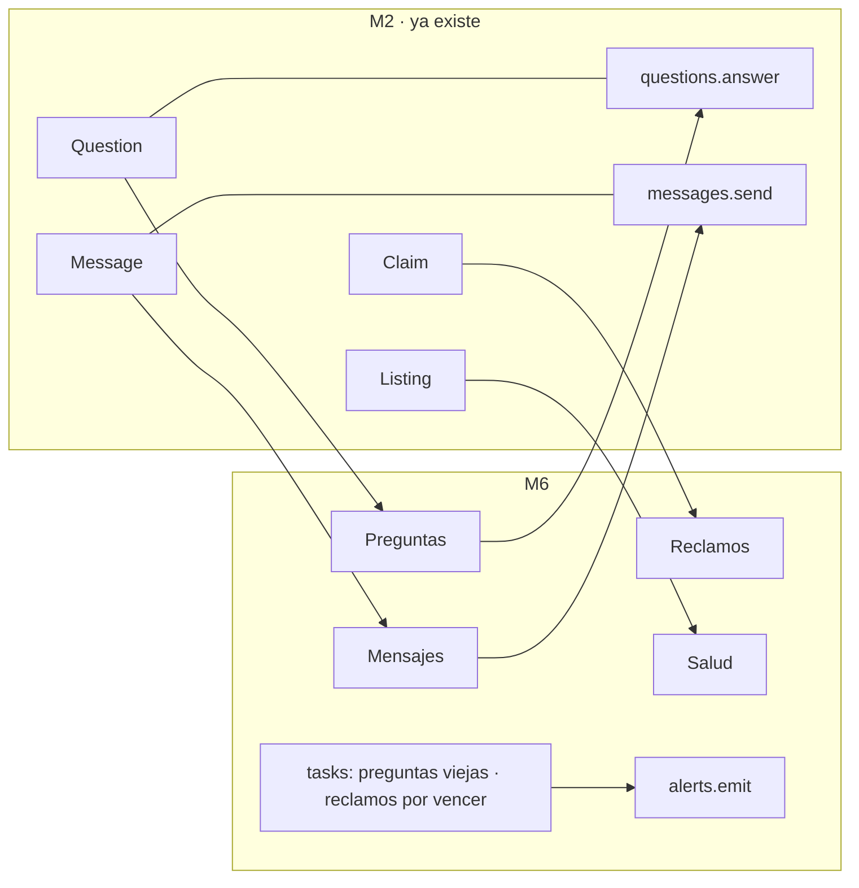

# Design: Operación de Mercado Libre (módulo M6)

**Status:** Approved (2026-11-14)
**Last updated:** 2026-11-14
**Requirements:** [requirements.md](./requirements.md) (aprobados 2026-11-14)

## Overview

Todo se construye sobre la app `conversations` (que ya tiene `Question`, `Message` y `Claim` de M2) y sobre `catalog.Listing`. M6 suma:

1. **Pantallas** bajo `/ml/` (`conversations/views.py`): preguntas, mensajes, reclamos y salud de publicaciones.
2. **Respuestas guardadas** (`SavedReply`, modelo nuevo).
3. **Servicios de lectura** (`conversations/inbox.py`, `conversations/health.py`): consultas de las bandejas, problemas de salud, guía de talles.
4. **Alertas periódicas** (`conversations/tasks.py`): preguntas sin responder y reclamos por vencer.
5. **Ajustes chicos en M2:** guardar en la publicación los datos de salud que hoy se descartan (`sub_status`, `tags`), y una función para pedir la guía de talles.

Las únicas escrituras en ML siguen siendo las de M2: `questions.answer()` y `messages.send()`.



## 1. Modelo de datos

### Nuevo: `conversations.SavedReply`

```python
class SavedReply(TimeStampedModel):
    title = CharField(max_length=80)  # "Talles", "Envíos a todo el país"
    text = TextField()
    is_active = BooleanField(default=True)  # baja lógica
    created_by = FK(User, PROTECT)

    class Meta:
        ordering = ["title"]
        permissions = [("manage_saved_replies", "Puede crear y editar respuestas guardadas")]
```

### Cambios

| Modelo | Cambio | Para qué |
|---|---|---|
| `Message` | índice `(thread_key, sent_at)` y índice parcial de no leídos `(direction='in', read_at IS NULL)` | Bandeja rápida |
| `Question` | índice `(status, asked_at)` | Bandeja ordenada por antigüedad |
| `Listing.data` (JSON, sin migración) | M2 suma `sub_status`, `tags`, `warnings` y `size_grid_id` (del atributo `SIZE_GRID_ID`) | Salud y guía de talles |
| `Listing.data["size_chart"]` | Guía de talles cacheada `{fetched_at, rows}` | No pedirla a ML cada vez |

### Permisos (roles)

| Permiso | Admin | Ventas | Vendedor | Depósito |
|---|---|---|---|---|
| `conversations.view_question` | ✓ | ✓ | ✓ | |
| `conversations.answer_question` (ya existe) | ✓ | ✓ | **✓ (nuevo)** | |
| `conversations.view_message` | ✓ | ✓ | ✓ | |
| `conversations.send_message` (ya existe) | ✓ | ✓ | **✓ (nuevo)** | |
| `conversations.view_claim` (ya existe) | ✓ | ✓ | | |
| `conversations.manage_saved_replies` | ✓ | ✓ | | |
| `catalog.view_listing_health` (nuevo) | ✓ | ✓ | | |

Etiquetas en castellano en `PERMISSION_LABELS`.

### Alertas nuevas (migración de datos)

| Código | Roles | Email | Dedupe |
|---|---|---|---|
| `ml.claim_due` "Reclamo por vencer" | Ventas, Admin | sí | `claim-due:{id}:{24h\|4h}` |
| `ml.question_unanswered_long` (ya existe) | Ventas, Admin | no | `question-long:{id}` |

`ml.claim_opened` cambia su `link_url` a `/ml/reclamos/{pk}/`.

### Settings

| Variable | Default | Uso |
|---|---|---|
| `ML_QUESTION_WARNING_HOURS` | 12 | Rojo en la bandeja y alerta |
| `ML_CLAIM_WARNING_HOURS` | `[24, 4]` | Avisos de reclamo |
| `ML_HEALTH_MIN_SCORE` | 0.7 | Debajo de este puntaje = "calidad baja" |
| `ML_LISTING_EDIT_URL` | `https://www.mercadolibre.com.ar/publicaciones/{id}/modificar` | Enlace "editar en ML" |
| `ML_CLAIM_URL` | `https://www.mercadolibre.com.ar/ventas/{order_id}/detalle` | Enlace "responder en ML" |
| `ML_SIZE_CHART_TTL_HOURS` | 24 | Vigencia del caché de la guía de talles |

Las dos URLs se confirman con la cuenta real. Por eso son configurables.

## 2. Preguntas (US-1)

`conversations/inbox.py`:

```python
def unanswered_questions() -> QuerySet[Question]     # status=UNANSWERED, select_related listing, order asked_at
def answered_questions(q: str = "", item: str = "")  # status=ANSWERED, búsqueda en texto/respuesta/título
def question_context(question) -> QuestionContext
    # listing + variaciones (ListingVariation con available_quantity y variant)
    # stock del catálogo: StockLevel del depósito por defecto por variante vinculada (1 consulta)
    # size_chart: health.size_chart(listing) (caché; si ML falla → None, no rompe la pantalla)
    # previous: hasta 10 preguntas respondidas de la misma publicación
```

**Respuesta:** la vista llama `questions.answer(MLClient(), question, text, user=...)` (M2).
- Si sale bien: mensaje "Respuesta enviada" y vuelve a la bandeja en la siguiente pregunta sin responder.
- Si ML la rechaza (`AnswerRejected`): se re-muestra la pantalla con el texto y el motivo. M2 ya conserva el texto en `draft_answer`.
- Errores de token o red: `integrations.errors.friendly`, sin 500.

**Respuestas guardadas:** un selector arriba del cuadro de texto inserta el texto con JS, sin pedir nada al servidor. La ABM está en `/ml/respuestas-guardadas/`, con permiso `manage_saved_replies`.

**Guía de talles** (`health.size_chart(listing)`):
- Si `data.size_grid_id` existe y el caché venció, `GET /catalog/charts/{id}` (sin escritura).
- Se normaliza a filas `{talle: {medida: valor}}` y se guarda en `Listing.data["size_chart"]`.
- Errores → `None` y log.

**Rojo y alerta:** `asked_at < now - ML_QUESTION_WARNING_HOURS`. La tarea periódica emite `ml.question_unanswered_long` una vez por pregunta.

## 3. Mensajes (US-2)

```python
def threads(*, only_unread=False) -> list[ThreadRow]
    # Agrupa Message por thread_key con agregados: último sent_at, último texto (Subquery),
    # no leídos = Count(filter=direction=IN & read_at null), document (pedido) del último mensaje.
    # Orden: con no leídos primero, después último sent_at desc. Paginado de a 50.

def thread(thread_key) -> (document, messages)       # orden sent_at
def mark_read(thread_key, user) -> int               # read_at=now en los IN sin leer (solo interno)
```

- Abrir la conversación marca como leídos en el sistema los mensajes del comprador. No se marca nada en ML (M2 sincroniza sin marcar), así que los mensajes también siguen sin leer en la app de ML. Es lo esperado.
- Responder: `messages.send(MLClient(), document, text, user=...)`. `MessagingBlocked` → mensaje en castellano, el texto queda en el formulario.
- La ficha del pedido (M4) suma "Ver conversación (N sin leer)" si hay mensajes.

## 4. Reclamos (US-3)

- Lista: `Claim.objects.filter(status="opened")` ordenada por `due_date` (nulls last) y `action_required` primero. Pestaña "Cerrados" de los últimos 90 días.
- Ficha `/ml/reclamos/<pk>/`: datos, pedido, devolución (`ReturnInfo` de M4 si existe), historial de `data` en castellano, enlace `ML_CLAIM_URL`.
- Textos en castellano: diccionario `CLAIM_REASONS`, `CLAIM_TYPES` y `CLAIM_STAGES` en `conversations/labels.py`. Lo desconocido se muestra tal cual.

**Tarea `claims_due`:** cada 5 minutos, en la misma tarea periódica que preguntas.
- Para cada reclamo abierto con `action_required` y `due_date`, y para cada umbral `h` en `ML_CLAIM_WARNING_HOURS`: si `due_date - now <= h` y no venció → `emit("ml.claim_due", dedupe=f"claim-due:{pk}:{h}h")`.
- El título dice cuánto falta y el link lleva a la ficha.

## 5. Salud de publicaciones (US-4)

`conversations/health.py`, sin escrituras:

```python
PROBLEMS = {
  "paused":        "Pausada",
  "under_review":  "En revisión / infracción",
  "incomplete":    "Ficha técnica incompleta",
  "low_quality":   "Calidad baja",
  "needs_review":  "Revisar datos (sistema)",
}
def problems_for(listing) -> list[Problem(code, reason)]
    # paused: status == "paused"; motivo por sub_status (out_of_stock → "sin stock", …)
    # under_review: status == "under_review" o sub_status/tags de moderación (forbidden, suspended, moderation_penalty)
    # incomplete: tags incomplete_technical_specs / warnings de atributos requeridos
    # low_quality: health < ML_HEALTH_MIN_SCORE, o tags poor_quality_picture / poor_quality_thumbnail
    # needs_review: listing.needs_review con review_notes
def listings_with_problems(filters) -> list[(listing, problems)]
```

- Se evalúa en Python sobre las publicaciones de ML no cerradas, con pocos miles. Se pagina de a 100 como "Calidad" de M3, con contadores por tipo.
- Excel con openpyxl, igual que M3.
- Motivos en castellano en `labels.HEALTH_REASONS`. Lo desconocido se muestra tal cual.

**Cambio en M2** (`listings.upsert_item`): guardar en `data` los campos `sub_status`, `tags`, `warnings` y `size_grid_id`. Las publicaciones ya importadas los toman en la próxima sincronización diaria del catálogo.

## 6. Pantallas, menú y URLs

Prefijo `/ml/` en `conversations/urls.py`:

| URL | Vista | Permiso |
|---|---|---|
| `/ml/preguntas/` | Bandeja sin responder | `view_question` |
| `/ml/preguntas/<pk>/` | Pregunta + contexto + responder | `view_question` (enviar: `answer_question`) |
| `/ml/preguntas/respondidas/` | Historial con búsqueda | `view_question` |
| `/ml/respuestas-guardadas/` | ABM | `manage_saved_replies` |
| `/ml/mensajes/` | Conversaciones | `view_message` |
| `/ml/mensajes/<thread_key>/` | Conversación + responder | `view_message` (enviar: `send_message`) |
| `/ml/reclamos/` | Lista abiertos / cerrados | `view_claim` |
| `/ml/reclamos/<pk>/` | Ficha | `view_claim` |
| `/ml/salud/` y `/ml/salud.xlsx` | Salud | `catalog.view_listing_health` |
| `/ml/contadores/` | Fragmento HTMX con contadores (preguntas, mensajes, reclamos) | login |

- **Menú:** grupo "Mercado Libre" con Preguntas (N), Mensajes (N), Reclamos (N) y Salud. Los contadores se cargan con HTMX cada 60 s, como la campana de alertas, así no suman consultas a cada página.
- **Celular:** en el celular primero se ve la lista; al tocar un ítem se abre el detalle en pantalla completa. En pantallas anchas, la pregunta y su contexto van en dos columnas. El cuadro de respuesta tiene un botón grande, que se bloquea al enviar.

## 7. Errores y casos borde

| Caso | Comportamiento |
|---|---|
| Pregunta respondida desde la app de ML mientras alguien escribe | `AnswerRejected` "ya fue respondida" → se muestra la respuesta que entró por la conciliación. |
| Pregunta borrada | Sale de la bandeja con el motivo y el texto escrito queda guardado. |
| ML desconectado o token vencido | Bandejas visibles con aviso arriba ("Mercado Libre está desconectado: las respuestas no se pueden enviar") y botón de enviar deshabilitado. |
| Guía de talles no disponible | No se muestra. La pantalla no falla. |
| Conversación sin pedido asociado | Se muestra con "pedido no encontrado" y se puede responder si M2 lo permite. Si no, el motivo. |
| Reclamo sin `due_date` | Al final de la lista y sin avisos de vencimiento. |

## 8. Testing

- `tests/test_operacion_ml.py`:
  - Preguntas: bandeja y orden, contexto (stock ML y catálogo, guía de talles cacheada con respx, falla de ML), responder OK y rechazado (texto conservado), respuestas guardadas y permisos.
  - Mensajes: agrupación por conversación, no leídos, marcar leído, envío bloqueado.
  - Reclamos: orden, avisos de 24 h y 4 h sin duplicar, link del aviso de reclamo nuevo.
  - Salud: cada tipo de problema desde datos de ML, filtros, Excel.
  - Alerta de pregunta vieja (una vez).
  - Permisos por rol en todas las URLs: Vendedor responde pero no ve reclamos ni salud; Depósito no ve nada.
- Presupuestos de consultas en `test_rendimiento.py` para las bandejas, reclamos y salud.

## Trade-offs

- **Contadores por HTMX vs context processor:** el context processor suma 3 consultas a cada página del panel. HTMX las hace cada 60 s y solo cuando se ve el menú, igual que la campana. Costo: el contador tarda hasta un minuto en actualizarse.
- **Salud evaluada en Python vs columnas nuevas:** materializar los problemas en columnas permitiría filtrar en SQL, pero suma migraciones y riesgo de que queden desactualizados. Con unos pocos miles de publicaciones, evaluar en Python tarda menos de un segundo (lo mismo se midió en "Calidad" de M3).
- **Leído solo interno:** marcar como leído en ML requiere otra escritura en el canal y cambiaría lo que ve el dueño en la app de ML. Se deja interno. Si molesta, es un cambio chico después.
- **Guía de talles cacheada en `Listing.data`:** evita un modelo nuevo. Se renueva cada 24 h o cuando cambia `size_grid_id`.

## Notas de implementación

Decisiones chicas tomadas al implementar (T1–T10), consistentes con los requisitos:

- **"Sin responder" incluye las preguntas con error al enviar** (`status=error`). M2 las marca así cuando ML rechaza el texto o falla el envío; siguen sin respuesta, así que quedan en la bandeja (con la marca "no se pudo enviar"), en el contador y en el aviso de pregunta vieja. Sin esto desaparecían de la bandeja.
- **Errores de red, token o límite al responder:** M2 los traduce a "El texto no es válido para Mercado Libre". La vista detecta la causa (sin respuesta HTTP, 5xx, 401 o 429) y muestra `integrations.errors.friendly(...)` con "lo que escribiste quedó guardado". M2 no se tocó.
- **Sincronización de roles:** `sync_roles_signal` corría al migrar `integrations`, antes de que existieran los permisos nuevos de `conversations` (`manage_saved_replies`). Ahora corre al migrar `conversations`, la última app propia de `INSTALLED_APPS`.
- **Guía de talles:** el caché guarda `{grid_id, fetched_at, columns, rows:[{size, measures, cells}]}`. `listings.upsert_item` reemplaza `data` entero, así que conserva `size_chart` si el `size_grid_id` no cambió (si cambia o desaparece, se descarta).
- **Avisos de reclamo:** si un reclamo se detecta cuando ya pasó más de un umbral (por ejemplo, entra con 3 h), se avisa solo el umbral más chico, para no mandar dos avisos juntos. `ML_CLAIM_WARNING_HOURS` se carga como lista separada por comas (`24,4`).
- **Adjuntos como enlace:** los adjuntos de ML no tienen URL pública. Se agregó `/ml/mensajes/<thread_key>/adjunto/<archivo>` (permiso `view_message`), que los baja de ML con `GET /messages/attachments/{id}` (solo lectura) y solo si el adjunto pertenece a esa conversación.
- **Contador "Reclamos (N)"** = reclamos abiertos que requieren nuestra respuesta.
- **Avisos ya emitidos:** la migración `alerts.0006` también reapunta los avisos `ml.claim_opened` existentes a la ficha del reclamo.
- **Auditoría:** acción nueva `ml.saved_reply_changed` para altas, ediciones y bajas de respuestas guardadas.
- **Ficha del pedido:** además de "Ver conversación (N sin leer)", cada reclamo enlaza a su ficha (con permiso `view_claim`) y muestra estado y motivo en castellano.
