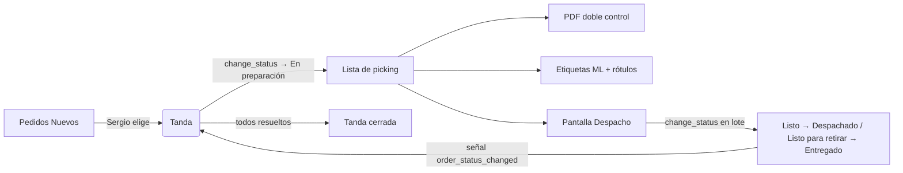

# Design: Preparación y despacho de pedidos (módulo M5)

**Status:** Approved (2026-11-14)
**Last updated:** 2026-11-14 (notas de implementación)
**Requirements:** [requirements.md](./requirements.md) (aprobados 2026-11-14)

## Overview

Una app nueva, `apps/fulfillment` ("preparación"), sobre el `SalesDocument` y el `Shipment` de `sales`. Pensada como el futuro módulo de depósito del ERP: las tandas no saben de canales, trabajan con documentos y líneas genéricas.

1. **Tandas de preparación** (`fulfillment/batches.py`): crear una tanda desde pedidos Nuevos, armar la lista de picking, sacar pedidos y cerrarla sola.
2. **Documentos imprimibles** (`fulfillment/pdf.py`): hoja A4 de doble control y rótulo 10×15 de transporte, con reportlab.
3. **Etiquetas** (`fulfillment/labels.py`): junta las etiquetas de ML (reusa `shipments.get_label` de M2) y los rótulos propios en un solo archivo.
4. **Despacho en lote** (`fulfillment/dispatch.py`): aplica `change_status` a varios pedidos y junta los que no pudieron avanzar.
5. **Pantallas** bajo `/pedidos/preparar/`, `/pedidos/tandas/` y `/pedidos/despacho/`.

Ningún componente cambia un estado por su cuenta: todo pasa por `apps/sales/states.change_status` (M4).



## 1. Modelo de datos

### App `fulfillment`

```python
class PickBatch(TimeStampedModel):
    class Status(TextChoices):
        OPEN = "open", "Abierta"
        CLOSED = "closed", "Cerrada"
    number = PositiveIntegerField(unique=True)          # correlativo, "Tanda 12"
    status = CharField(choices=Status, default=OPEN, db_index=True)
    created_by = FK(User, PROTECT)
    closed_at = DateTimeField(null=True)

class PickBatchOrder(TimeStampedModel):
    batch = FK(PickBatch, CASCADE, related_name="items")
    document = FK("sales.SalesDocument", PROTECT, related_name="pick_items")
    resolved_at = DateTimeField(null=True)             # salió (despachado / para retirar / cancelado)
    removed_at = DateTimeField(null=True)              # lo sacaron de la tanda
    removed_by = FK(User, null=True, SET_NULL)
    # Restricción: un pedido está como máximo en UNA tanda activa
    # UniqueConstraint(fields=["document"], condition=Q(removed_at__isnull=True, resolved_at__isnull=True),
    #                  name="one_active_batch_per_order")

class Carrier(TimeStampedModel):                       # expresos / transportes
    name = CharField(max_length=100, unique=True)
    is_active = BooleanField(default=True)
```

Permisos nuevos (`fulfillment`): `manage_carriers` (editar la lista de expresos). Las acciones de preparación y despacho usan el permiso que ya existe, `sales.change_order_status`.

| Rol | Permisos nuevos |
|---|---|
| Administrador | `fulfillment.view_pickbatch`, `fulfillment.manage_carriers` |
| Depósito | `fulfillment.view_pickbatch` |
| Ventas | `fulfillment.view_pickbatch` |
| Vendedor | — |

### Cambios en `sales.Shipment`

| Campo | Tipo | Para qué |
|---|---|---|
| `packages` | PositiveSmallIntegerField null | Bultos (rótulo de transporte) |
| `label_printed_at` | DateTimeField null | Mostrar "ya impresa" |
| `label_print_count` | PositiveSmallIntegerField default 0 | Reimpresiones |

`carrier_name` (ya existe) guarda el expreso elegido. `tracking_number` (ya existe) guarda la guía.

### Configuración (`settings` + `.env`)

| Variable | Default | Uso |
|---|---|---|
| `SENDER_NAME`, `SENDER_TAX_ID`, `SENDER_ADDRESS`, `SENDER_PHONE` | "" | Remitente del rótulo. Si falta el nombre, el rótulo dice "Deutsch". |
| `TN_ADMIN_ORDER_URL` | "" | Plantilla del enlace al pedido en el admin de TN (`...{id}`). Vacía: solo el texto "Se imprime desde Tiendanube". |
| `FULFILLMENT_MAX_BATCH` | 60 | Tope de pedidos por tanda (para el PDF y la carga). |

## 2. Tandas (US-1, US-4)

`fulfillment/batches.py`:

```python
PREPARABLE_METHODS = todos menos ME_FULL  # Flex, Colecta, correo, Envío Nube, retiro, transporte, otro

def preparable_orders() -> QuerySet[SalesDocument]
    # status=NEW, doc_type=ORDER, canal en (tiendanube, mercadolibre, manual),
    # sin envío Full, sin tanda activa; orden: fecha límite (nulls last), issued_at.

def create_batch(document_ids: list[int], *, user, request=None) -> tuple[PickBatch | None, list[Excluded]]
    # transaction.atomic + select_for_update de los documentos (en orden de pk, evita deadlocks).
    # Por cada uno: si ya no está en NEW o está en otra tanda → Excluded(doc, motivo).
    # Para los válidos: change_status(doc, PREPARING, user=user, reason=f"Tanda {n}").
    # Si no quedó ninguno → (None, excluded) y no se crea la tanda.
    # Audita "fulfillment.batch_created" con la lista de pedidos.

def picking_list(batch) -> PickingList
    # Líneas de los pedidos activos de la tanda. Agrupa por variant_id
    # (o por sku_snapshot si no hay variante → sección "no está en el catálogo").
    # Cada fila: sku, descripción (producto + atributos), total, destinos [(ref, cant)].
    # Orden por SKU. Cantidades con normalize() (sin ".000").

def remove_order(batch, document, *, user, request=None)
    # Marca removed_at/by; si el pedido está en PREPARING → change_status(NEW, reason="Sacado de la tanda N").
    # Audita "fulfillment.order_removed". Llama a close_if_done.

def on_status_changed(document, old, new)
    # Receptor de la señal. new ∈ {DISPATCHED, READY_FOR_PICKUP, DELIVERED, CANCELLED} → resolved_at.
    # new == NEW (alguien lo devolvió desde la ficha) → removed_at.
    # Después close_if_done(batch).

def close_if_done(batch)
    # Si no quedan items activos → status CLOSED, closed_at, audita "fulfillment.batch_closed".
```

**Señal nueva** en `sales/signals.py`: `order_status_changed(sender, document, old, new, system)`. `change_status` la envía con `transaction.on_commit`. Así `sales` no importa `fulfillment` (la dependencia va de fulfillment hacia sales, como en un ERP modular).

`Excluded` motivos (texto para Sergio): "ya no está Nuevo (ahora: «En preparación»)", "ya está en la tanda 11", "es Full: lo despacha Mercado Libre".

## 3. PDF de doble control (US-2)

`fulfillment/pdf.py` con **reportlab** (puro Python, sin dependencias del sistema; WeasyPrint necesita GTK en Windows).

`checklist_pdf(batch) -> bytes`, A4 vertical, márgenes 12 mm, Helvetica (cubre acentos y ñ):

- **Encabezado** en cada página: "Tanda 12 · 14/11/2026 15:40 · Sergio · 8 pedidos · 23 unidades" y "Página 1 de 3".
- **Parte 1 · Picking por producto:** tabla `[☐ Juntado][☐ Verificado] | SKU | Descripción | Cant. | Pedidos`. Las casillas son celdas vacías con borde de 6 mm (no dependen de que la fuente tenga el carácter ☐). La sección "No está en el catálogo" va al final de la parte 1.
- **Parte 2 · Armado por pedido:** un bloque por pedido que no se corta entre páginas (`KeepTogether`): título "TN #1234 · Lucía Gómez · Flex · despachar antes de 16:00", tabla `[☐ Armado][☐ Controlado] | SKU | Descripción | Cant.`, y al pie "Armó: ______  Controló: ______".
- Orden de la parte 2: fecha límite, después antigüedad.

Se sirve con `Content-Disposition: inline` para que el navegador lo abra y se imprima. Nombre: `tanda-12.pdf`.

## 4. Etiquetas y rótulos (US-3)

`fulfillment/labels.py`:

```python
def ml_labels(shipments) -> LabelBundle
    # Para cada envío con método en LABEL_METHODS: shipments.get_label(client, s) (M2, cachea el archivo).
    # LabelNotReady → se saltea y se anota el motivo traducido.
    # PDF: une las páginas con pypdf. ZPL: concatena los textos.
    # Devuelve LabelBundle(content, fmt, printed=[...], skipped=[(doc, motivo)]).

def carrier_label(shipment, *, carrier: str, packages: int, user) -> bytes
    # Guarda carrier_name y packages en el envío; pdf.carrier_label_pdf(...) → una página por bulto.

def mark_printed(shipments, *, user, request, kind)
    # label_printed_at=now, label_print_count+=1, audita "shipment.label_printed" (ml | rotulo).
```

**Rótulo 10×15** (`pdf.carrier_label_pdf`), página 100 × 150 mm:

```
┌──────────────────────────┐
│ REMITENTE  Deutsch …     │
│ DESTINATARIO             │
│  Lucía Gómez  DNI …      │
│  Av. Siempreviva 742 …   │
│  Tel …                   │
│ EXPRESO  Vía Cargo       │
│ PEDIDO   Manual #45      │
│ ▌▌▌ código de barras ▌▌▌ │   (Code128 del número de pedido, reportlab)
│ BULTO 2 DE 3             │
└──────────────────────────┘
```

Datos del destinatario: `Customer` (nombre, documento, teléfono) y `Shipment.address` con el filtro `address_text` ya existente.

**Lote:** un botón "Etiquetas ML de la tanda" (y otro sobre los marcados en Despacho) baja un solo archivo. Los rótulos de transporte se imprimen por pedido, porque cada uno pide expreso y bultos. Si en la tanda hay pedidos de transporte, la pantalla los lista con su formulario.

Envío Nube: sin etiqueta en el sistema. El pedido muestra "La etiqueta se imprime desde Tiendanube", con enlace si `TN_ADMIN_ORDER_URL` está configurada.

**Por qué no usar el lote nativo de ML** (`/shipment_labels?shipment_ids=a,b,c`): si un envío no está listo, ML rechaza el lote entero. Pidiendo de a uno (con el caché de M2) se imprime lo que está listo y se informa lo que falta. Con menos de 30 envíos por día el costo en llamadas es irrelevante.

## 5. Despacho (US-4)

`fulfillment/dispatch.py`:

```python
ACTIONS = {
    "listo":     (PREPARING,        READY),
    "despachar": (READY,            DISPATCHED | READY_FOR_PICKUP según is_pickup),
    "entregar":  (READY_FOR_PICKUP, DELIVERED),
}

def advance(document_ids, action, *, user, request, tracking: dict[int, str]) -> Result(done, failed)
    # Para cada pedido: verifica el origen esperado; change_status(...) con tracking_code si vino.
    # TransitionNotAllowed u origen distinto → failed.append((doc, motivo)). Cada pedido en su propia
    # transacción (change_status ya es atómico): uno que falla no frena a los demás.
    # Si vino tracking y el envío es de transporte, se guarda en Shipment.tracking_number.
```

En pedidos de Tiendanube, `change_status` ya encola el aviso a Tiendanube (M1). Despacho no agrega nada.

## 6. Pantallas y URLs

Todo dentro de `sales/urls.py` para el prefijo `/pedidos/`, con vistas en `fulfillment/views.py`:

| URL | Vista | Permiso |
|---|---|---|
| `/pedidos/preparar/` | Pedidos Nuevos preparables, filtros canal y envío, casillas, "Armar tanda" | `sales.change_order_status` |
| `/pedidos/tandas/` | Tandas abiertas (y cerradas de los últimos 7 días) | `fulfillment.view_pickbatch` |
| `/pedidos/tandas/<n>/` | Picking en pantalla (casillas tildables solo visuales, con `localStorage`), pedidos de la tanda, sacar pedido, rótulos de transporte | `fulfillment.view_pickbatch` |
| `/pedidos/tandas/<n>/hoja.pdf` | PDF doble control | `fulfillment.view_pickbatch` |
| `/pedidos/tandas/<n>/etiquetas/` | Etiquetas ML de la tanda (un archivo) | `sales.change_order_status` |
| `/pedidos/<pk>/etiqueta/` | Etiqueta ML de un pedido | `sales.change_order_status` |
| `/pedidos/<pk>/rotulo/` | GET formulario (expreso, bultos) · POST → PDF | `sales.change_order_status` |
| `/pedidos/despacho/` | Grupos En preparación / Listo / Listo para retirar, casillas, acciones en lote, guía por fila | `sales.change_order_status` |
| `/pedidos/expresos/` | Lista editable de expresos | `fulfillment.manage_carriers` |

- Menú: "Preparar" y "Despacho" para quien puede cambiar estados, "Tandas" para quien las ve.
- La ficha del pedido (M4) suma: tanda a la que pertenece, botón de etiqueta ML o rótulo según el envío, y "ya impresa (2 veces)".
- Celular: tarjetas con casillas grandes (área táctil de 44 px), botones fijos abajo en Preparar y Despacho.
- Mensajes después de cada acción en lote: "Se armó la tanda 12 con 8 pedidos. Quedaron afuera 2: TN #1240 (ya está en la tanda 11) …".

## 7. Errores y casos borde

| Caso | Comportamiento |
|---|---|
| Dos personas arman tandas con el mismo pedido a la vez | `select_for_update` + restricción única: el segundo lo recibe en "quedaron afuera". |
| El canal cancela un pedido que está en una tanda | M4 lo pasa a Cancelado; la señal lo marca resuelto; la tanda muestra "Cancelado: devolver a la estantería" (la alerta de M4 ya avisa a administración). |
| Etiqueta ML no lista | Se saltea con el motivo de ML traducido; las demás se imprimen. |
| Token de ML vencido al pedir etiquetas | Mensaje de `integrations.errors.friendly` ("hay que reconectar…"); no da error 500. |
| Tanda sin pedidos válidos | No se crea; mensaje con los motivos. |
| Más de `FULFILLMENT_MAX_BATCH` pedidos marcados | Error en el formulario: "Una tanda puede tener hasta 60 pedidos". |
| Pedido sin domicilio para el rótulo | El rótulo sale con "Domicilio: completar a mano" y la pantalla avisa antes de imprimir. |

## 8. Testing

- `tests/test_preparacion.py`:
  - Tandas: crear, exclusiones (no Nuevo, otra tanda, carrera simulada), picking agrupado y orden, sacar pedido, cierre automático por señal (despachado, retiro, cancelado por canal).
  - Despacho en lote: éxito parcial, retiro vs envío, guía, Tiendanube encola el aviso.
  - Etiquetas: lote con una no lista (respx), PDF unido con la cantidad de páginas correcta, ZPL concatenado, rótulo con N páginas por bulto y tamaño 100×150 mm.
  - PDF de doble control: genera, tiene las dos partes (texto extraíble con pypdf), 50 pedidos en menos de 3 s.
  - Permisos por rol en cada URL.
- Presupuesto de consultas de las pantallas nuevas en `tests/test_rendimiento.py`.

## Notas de implementación (2026-11-14)

Decisiones chicas tomadas al implementar, dentro de lo aprobado:

- **Número de tanda:** sale de una secuencia de Postgres (`fulfillment_batch_number_seq`, migración `fulfillment.0002`), igual que la numeración de `sales`. Dos tandas armadas a la vez no chocan.
- **Qué pedidos entran en la lista de picking y la hoja:** los de la tanda que no se sacaron y no están cancelados (también los ya despachados, para poder reimprimir la hoja de una tanda). Los cancelados se muestran aparte en el detalle de la tanda con "Cancelado: devolver la mercadería a la estantería".
- **Sacar un pedido:** URL extra `POST /pedidos/tandas/<n>/sacar/<pk>/`. Si el pedido está En preparación vuelve a Nuevo; si ya está Listo sale de la tanda y queda en Listo (M4 no permite Listo → Nuevo).
- **Etiquetas como POST:** `/pedidos/<pk>/etiqueta/`, `/pedidos/tandas/<n>/etiquetas/` y "Etiquetas ML de los marcados" en Despacho son POST (registran la impresión y la auditan; llevan CSRF). El archivo se abre en otra pestaña y la pantalla se recarga sola para mostrar el aviso de las que faltaron.
- **Motivos de ML en castellano:** ML responde en inglés ("Shipment not ready to print"); se traduce a "Mercado Libre todavía no habilita la etiqueta: el envío no está listo para imprimir", "…la venta no está pagada" o "el envío se canceló en Mercado Libre". Token vencido o red: `integrations.errors.friendly`.
- **Ficha del pedido:** el bloque de M5 (tanda, botón de etiqueta o rótulo, "ya impresa", aviso de Envío Nube) se dibuja con el template tag `` de `fulfillment`, así `sales/views.py` no importa `fulfillment`.
- **Enlace a Tiendanube:** `TN_ADMIN_ORDER_URL` se completa con el id del pedido en TN guardado en `ExternalRef`.
- **Auditoría extra:** `fulfillment.carrier_changed` (alta, baja o reactivación de un expreso). `shipment.label_printed` se registra sobre el pedido para que aparezca en su historial.
- **Guía en Despacho:** el campo aparece en los pedidos Listos que no son de retiro ni de ML. Se manda a `change_status` como `tracking_code` (TN lo recibe) y se guarda en `Shipment.tracking_number` cuando el envío es por transporte.
- **Atributos de la variante:** Postgres (jsonb) no conserva el orden de las claves; la descripción ordena talle y color primero ("Buzo (M / Negro)").

## Trade-offs

- **reportlab vs WeasyPrint vs imprimir HTML:** WeasyPrint permite diseñar con HTML/CSS, pero en Windows y en el contenedor necesita librerías del sistema (GTK/Pango). Imprimir HTML depende del navegador y de los márgenes de cada impresora. reportlab es puro Python y da medidas exactas en mm, lo que importa en la térmica 10×15. Costo: el diseño se escribe en código.
- **Tanda como modelo propio vs un campo en el pedido:** un campo `batch_number` en `SalesDocument` sería más simple, pero pierde el historial (sacar y volver a meter) y mezcla depósito con ventas. El modelo propio es la base del futuro módulo de depósito del ERP (F-xx).
- **Señal vs llamada directa:** `change_status` podría llamar a fulfillment directamente. La señal evita que el núcleo de ventas dependa del módulo de depósito.
- **Casillas en pantalla solo visuales:** guardar cada tilde en la base daría trazabilidad fina, pero suma escrituras y complejidad sin pedido explícito. La trazabilidad formal es la hoja firmada y la auditoría de estados.

## Dependencias nuevas

- `reportlab` (PDF y código de barras) y `pypdf` (unir etiquetas, leer PDFs en tests). Ambas puro Python, licencias BSD.
