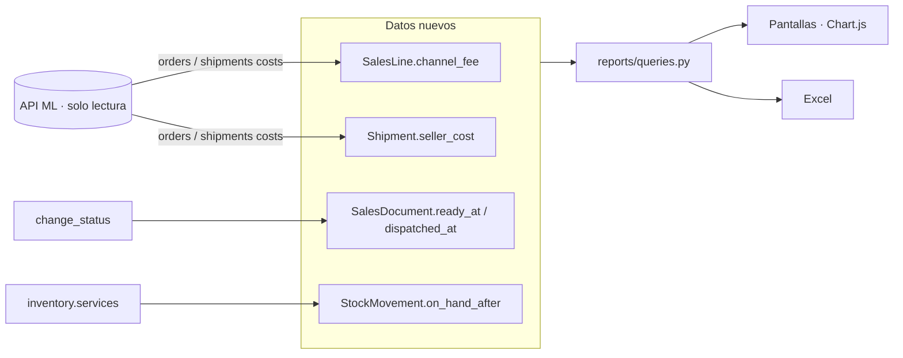

# Design: Reportes (módulo M7)

**Status:** Approved (2026-11-15)
**Last updated:** 2026-11-15
**Requirements:** [requirements.md](./requirements.md) (aprobados 2026-11-15)

## Overview

Una app nueva, `apps/reports`, que solo lee. Pensada como el módulo de reportes del futuro ERP: consulta los modelos genéricos (`SalesDocument`, `SalesLine`, `Variant`, `StockMovement`, `Question`) y no sabe de canales salvo para agrupar.

Para que los reportes sean exactos y rápidos, hacen falta cuatro datos que hoy no se guardan:

1. **Comisión de ML por línea** (`SalesLine.channel_fee`) y **costo de envío del vendedor** (`Shipment.seller_cost`). Se leen de la API de ML.
2. **Momentos del pedido:** cuándo quedó listo para preparar (`SalesDocument.ready_at`) y cuándo salió (`SalesDocument.dispatched_at`). Los fija `change_status` y se completan para atrás desde la auditoría.
3. **Stock después de cada movimiento** (`StockMovement.on_hand_after`), para detectar cuándo una variante quedó en 0.

Con eso, cada pantalla es un puñado de consultas agregadas en Postgres (sin recorrer pedidos en Python). Los gráficos se dibujan con Chart.js.



## 1. Datos nuevos

### Campos

| Modelo | Campo | Tipo | Se llena |
|---|---|---|---|
| `SalesLine` | `channel_fee` | Decimal(14,2) null | ML: `order_items[].sale_fee × quantity` al hacer el upsert. TN y manuales: null (= 0). |
| `Shipment` | `seller_cost` | Decimal(14,2) null | ML: `GET /shipments/{id}/costs` → `senders[].cost`. Se pide una vez cuando el envío llega a `ready_to_ship` o después, si está vacío. |
| `SalesDocument` | `ready_at` | DateTime null, índice | Primera vez que pasa a Nuevo. Si entró pagado, es `issued_at`. |
| `SalesDocument` | `dispatched_at` | DateTime null, índice | Primera vez que pasa a Despachado o Listo para retirar. |
| `SalesDocument` | `net_pending` | Bool default False | Venta de ML a la que le falta la comisión o el costo de envío. |
| `StockMovement` | `on_hand_after` | Decimal null | Lo fija `inventory.services` en cada movimiento que afecta `on_hand`. |

### Backfill (comando y tarea, se puede repetir)

- `reports_backfill timestamps`: completa `ready_at` y `dispatched_at` desde `AuditLog` (`order.status_changed`, con `after.estado`). Lo que no tenga auditoría usa `issued_at` o `status_changed_at`.
- `reports_backfill stock`: reconstruye `on_hand_after` hacia atrás desde el `StockLevel` actual, restando los deltas en orden inverso.
- `reports_backfill ml_fees`: tarea Procrastinate que recorre las ventas de ML con `net_pending=True` en tandas de 50, respetando el límite de la API (`RateLimitBucket` de M0). Se encola sola al migrar y después corre una vez por día para lo que haya quedado pendiente.

### Permiso

`reports.view_reports`, solo para el rol Administrador, con la etiqueta "Ver reportes".

## 2. Reglas de cálculo

| Concepto | Definición |
|---|---|
| Venta | `SalesDocument` tipo pedido, estado ≠ Cancelado, `issued_at` en el período (hora Argentina). |
| Bruto | `SalesDocument.total`. Por línea: `SalesLine.line_total`, prorrateado si hace falta para que la suma por línea coincida con el total del pedido (envío y descuentos van aparte, ver abajo). |
| Neto | Bruto − Σ `channel_fee` − Σ `seller_cost`. En TN y manuales, neto = bruto. |
| Envío y descuentos en tablas por producto | Las tablas por producto, talle o color suman `line_total` (lo que pagó el cliente por el producto). El envío no se reparte entre productos. Los totales del resumen usan `SalesDocument.total`. |
| Período anterior | Mismo largo, inmediatamente antes. |
| Tiempo de respuesta | `answered_at − asked_at` de preguntas respondidas en el período. "Por persona" solo cuenta las que tienen `answered_by`. |
| Tiempo de despacho | `dispatched_at − ready_at` de pedidos despachados en el período. Excluye Full (lo despacha ML). |
| Flex/Colecta a tiempo | `dispatched_at ≤ dispatch_deadline` del envío. |
| Se agota | Movimiento con `on_hand_after ≤ 0` cuando el saldo anterior era `> 0`. "Días sin stock" = suma de los tramos con saldo ≤ 0 dentro del período. |

Los percentiles se calculan en Postgres con `percentile_cont` (función de agregación propia, `Percentile`, en `reports/aggregates.py`).

## 3. Consultas (`reports/queries.py`)

Todas reciben un `Filters(start, end, channel)` y devuelven listas de dicts:

```python
def kpis(f) -> dict                    # bruto, neto, pedidos, unidades, ticket, cancelados, devoluciones + período anterior
def sales_by_day(f) -> list            # TruncDate(issued_at, tz) × canal
def channel_share(f) -> list
def heatmap(f) -> list[list[int]]      # ExtractIsoWeekDay × ExtractHour (tz)
def sales_table(f, group_by, order)    # group_by ∈ canal|producto|variante|talle|color|dia|semana|mes
    # talle/color: KeyTextTransform("talle"/"color", "variant__attributes"); sin variante → "Sin vincular (SKU)"
def top_products(f, by="unidades")     # top 50 productos y variantes + stock actual (depósito por defecto)
def stockouts(f, min_times=2) -> list  # sobre StockMovement.on_hand_after con LAG() por variante
def response_times(f) -> dict          # mediana, p90, % <1 h, % <12 h, por persona
def dispatch_times(f) -> list          # por canal y forma de envío
def flex_on_time(f) -> dict            # % a tiempo + lista de tardíos
def manual_pending() -> list           # a la fecha (no depende del período)
```

Índices nuevos:
- `SalesDocument (doc_type, status, issued_at)` (ya existe uno parecido de la auditoría M0–M4: se reusa si alcanza);
- `StockMovement (variant, created_at)`;
- `Question (answered_at)`.

## 4. Pantallas

Prefijo `/reportes/`, todas con `reports.view_reports`:

| URL | Contenido |
|---|---|
| `/reportes/` | **Resumen:** filtros, 7 indicadores con variación (▲▼ en verde o rojo), ventas por día por canal (barras apiladas), participación por canal (dona), días y horas pico (tabla de calor con CSS). Avisos: "N ventas de ML con neto pendiente" y "Tiendanube y manuales sin comisiones del canal". |
| `/reportes/ventas/` | Tabla agrupable (selector "Agrupar por"), columnas ordenables, totales al pie, paginada de a 100. |
| `/reportes/productos/` | Más vendidos (productos y variantes, por unidades o por bruto) y "Se agotan seguido". |
| `/reportes/operacion/` | Tiempos de respuesta (general y por persona), tiempos de despacho (por canal y envío), Flex/Colecta a tiempo y lista de tardíos, manuales pendientes. |
| `…/excel/` en cada una | El Excel de lo que se ve, con los mismos filtros, generado con XlsxWriter en modo `constant_memory` (rápido para muchas filas). |

- Los filtros viajan en la URL, así un reporte se puede guardar como favorito o compartir.
- **Chart.js 4.4.x** desde cdnjs, con los datos inyectados con `json_script`. Paleta accesible y consistente por canal: Tiendanube, Mercado Libre y manual siempre del mismo color.
- **Celular:** los indicadores van en 2 columnas, los gráficos a lo ancho y las tablas con scroll horizontal.
- **Menú:** "Reportes", solo para Administrador.

## 5. Cambios en módulos existentes

| Módulo | Cambio |
|---|---|
| M2 `mercadolibre/orders.py` | Al hacer el upsert, guarda `sale_fee` por línea y marca `net_pending` si falta. |
| M2 `mercadolibre/shipments.py` | En `refresh`, si `seller_cost` es null y el estado es ready_to_ship o posterior, pide `/shipments/{id}/costs` (lectura, cliente rápido de 4 s; si falla, se reintenta en el backfill diario). Recalcula `net_pending`. |
| M4 `sales/states.change_status` | Fija `ready_at` (primera vez que pasa a Nuevo) y `dispatched_at` (primera vez que pasa a Despachado o Listo para retirar). En la creación, `ready_at = issued_at` si entra pagado. |
| M0/M3 `inventory/services.py` | Cada movimiento que afecta `on_hand` guarda `on_hand_after`. |

Ninguno de estos cambios escribe en un canal.

## 6. Errores y casos borde

| Caso | Comportamiento |
|---|---|
| Período sin datos | Indicadores en 0 y gráficos con "No hay ventas en este período". |
| Rango inválido o mayor a 2 años | Se ajusta a 2 años y se avisa. |
| ML desconectado durante el backfill | La tarea se detiene y reintenta al día siguiente. El tablero sigue mostrando "neto pendiente". |
| Variante sin talle o color en atributos | Se agrupa como "Sin talle" / "Sin color". |
| Pedido despachado sin `ready_at` | Se usa `issued_at`. |
| Stock sin historial suficiente (`on_hand_after` null) | Esa variante no entra en "Se agotan seguido". Se avisa: "historial de stock desde el DD/MM". |

## 7. Testing

- `tests/test_reportes.py`:
  - Cada consulta con datos armados a mano y resultados exactos: bruto/neto, período anterior, zona horaria en el límite de medianoche, cancelados excluidos, sin vincular.
  - Talle y color, top 50, stockouts con `LAG`, percentiles, Flex a tiempo, manuales pendientes.
  - Backfills: timestamps desde auditoría, stock reconstruido, comisiones de ML con respx (incluido el límite de la API).
  - Excel: columnas y totales.
  - Permisos: solo Administrador; Ventas, Depósito y Vendedor reciben 403.
- `test_rendimiento.py`: 10.000 pedidos y 20.000 líneas. Cada pantalla en menos de 2 s y con cantidad de consultas acotada. Excel de 50.000 filas en menos de 10 s.

## Trade-offs

- **Columnas nuevas vs calcular en el momento:** `dispatched_at` se podría sacar de la auditoría en cada consulta, y el saldo de stock reconstruir al vuelo. Funciona, pero es lento con un año de datos y complica las consultas. Guardarlos cuesta unas migraciones y un backfill único, y deja consultas simples e indexables.
- **Postgres agregando vs pandas:** pandas suma una dependencia pesada y memoria. Las agregaciones (TruncDate, Extract, `percentile_cont`, `LAG`) las resuelve Postgres directamente.
- **Chart.js vs gráficos en el servidor:** Chart.js es liviano, interactivo (tooltips) y responsivo en el celular. Las imágenes del servidor no tienen interacción.
- **Neto solo de ML:** TN cobra su comisión por fuera de la API. Inventar un porcentaje engañaría más de lo que ayuda: se muestra bruto con la aclaración.

## Notas de implementación

Decisiones tomadas al implementar T1–T9 (2026-11-15), donde el diseño no alcanzaba o no era viable tal cual:

1. **Excel con XlsxWriter, no openpyxl.** openpyxl en modo `write_only` tardó 12–14 s para 50.000 filas (requisito < 10 s). Primero se escribió un generador propio; el 2026-11-15 se decidió usar XlsxWriter (`constant_memory`), que garantiza compatibilidad con Excel: 50.000 filas en ≈ 3,5 s. Los tests lo leen de vuelta con openpyxl.
2. **Índice `(doc_type, status, issued_at)`:** no se agregó. Se reusa `salesdoc_type_issued_idx (doc_type, -issued_at)`, que alcanza: con 10.000 pedidos cada pantalla tarda menos de 0,9 s. Sí se agregaron `StockMovement (variant, created_at)`, `Question (answered_at)` y los índices de `ready_at` / `dispatched_at`.
3. **Bruto por línea sin prorrateo.** Las tablas por producto, variante, talle y color suman `line_total` (sin envío ni prorrateo), y el neto ahí descuenta solo la comisión. Las agrupaciones por canal y por tiempo usan el total del pedido, y su neto descuenta también el costo de envío del vendedor, así coinciden con el resumen.
4. **"Sin vincular (SKU)"** se usa en producto, variante, talle y color, una fila por SKU del canal. Una variante sin la clave queda en "Sin talle" / "Sin color". Las claves de atributos se leen sin importar mayúsculas (`Talle` / `talle`), porque Tiendanube las guarda con mayúscula.
5. **Gráfico de ventas:** muestra por día hasta 92 días, por semana hasta 366 y por mes por encima de eso, para que siga siendo legible.
6. **`on_hand_after`** solo se guarda en los movimientos que cambian el físico; "Se agota" mira el físico del depósito por defecto. El backfill de stock recalcula todos los movimientos `on_hand` desde el saldo actual con una función de ventana (idempotente).
7. **`ready_at`:** se toma de la primera transición Esperando pago → Nuevo. Si el pedido nunca esperó pago, vale `issued_at`, y un "volver a Nuevo" posterior no cuenta. Un pedido que esperó pago y se canceló queda vacío. **`dispatched_at`:** si el cambio lo hace el sistema y el canal informa `shipped_at`, vale esa fecha (cubre los pedidos viejos que se importan ya despachados). Al pasar a Entregado sin despacho previo se usa `shipped_at` y, si no hay, queda vacío.
8. **Comisiones de ML:** el snapshot de cada orden guarda `sale_fee`, y `channel_fee = sale_fee × cantidad`. `net_pending` se calcula con las líneas y con los envíos que figuran en los snapshots (el `Shipment` puede no existir todavía). Una venta sin envío de ML no tiene costo de envío. Una migración de datos marca como pendientes las ventas de ML ya importadas. El backfill `ml_fees` vuelve a leer `/orders/{id}` y llama a `upsert_order(force=True)`, más `/shipments/{id}/costs`, todo por `MLClient`, que ya pasa por el token bucket de M0. Se corta ante credenciales faltantes, token revocado o espera del límite.
9. **Sincronización de roles:** `sync_roles_signal` corre con la última app propia de `INSTALLED_APPS` (hoy `reports`) y ya no con `conversations` fija, así el permiso nuevo queda asignado en el primer migrate.
10. **Permiso:** `Report` es un modelo sin tabla (`managed=False`) que solo sirve para colgar `reports.view_reports`.
