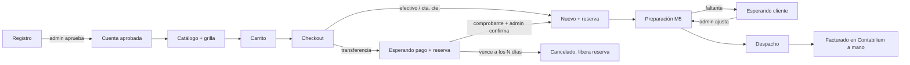

# Design: Tienda mayorista · etapa A (módulo M8a)

**Status:** Approved (2026-11-15)
**Last updated:** 2026-11-15
**Requirements:** [requirements.md](./requirements.md) (aprobados 2026-11-15)

## Overview

La tienda es una parte nueva del mismo sistema Django, no un sitio aparte. Comparte usuarios, catálogo, stock, pedidos, alertas y auditoría. Va en una app nueva, `apps/wholesale`, con su propio sistema de URLs, plantillas y estilo.

1. **Clientes** (`wholesale/accounts.py`): registro, aprobación, cuenta corriente y saldo a favor.
2. **Catálogo** (`wholesale/catalog.py`): productos con precio MAYORISTA > 0, disponibilidad por variante y filtros.
3. **Carrito y checkout** (`wholesale/cart.py` y `wholesale/checkout.py`): grilla, mínimo, entrega, pago y creación del pedido con precios congelados y reserva de stock.
4. **Pagos** (`wholesale/payments.py`): comprobantes privados, confirmación desde el panel y vencimiento automático.
5. **Emails** (`wholesale/mail.py`): plantillas editables y cola de envío.
6. **Pedidos en nombre de** (`wholesale/acting.py`): un vendedor o administrador compra como un cliente.
7. **Faltantes** (`wholesale/shortages.py`) y **reportes mayoristas** (en `apps/reports`).
8. **Sistema de diseño** (`static/brand/`, `templates/store/components/`): tokens y componentes de marca.

Los pedidos son `SalesDocument` del canal `mayorista`, que ya existe sembrado desde M0. Entran al centro de pedidos (M4), a la preparación (M5) y a los reportes (M7) sin código especial. Todo cambio de estado pasa por `change_status`.



## 1. Dónde vive la tienda

- **URLs:** `apps/wholesale/urls.py`, montadas en `/mayorista/` (setting `WHOLESALE_PATH`).
- **Host propio:** un middleware chico (`WholesaleHostMiddleware`) cambia `request.urlconf` al de la tienda cuando el host coincide con `WHOLESALE_HOST`. Así en la etapa B `mayoristas.deutsch.com.ar` sirve la tienda en la raíz sin tocar código.
- **Base y menú propios:** la tienda tiene su `templates/store/base.html`. No comparte menú con el panel.
- **Separación de accesos:**
  - Un usuario es **cliente** si tiene `CustomerAccount`.
  - El mixin del panel (`PanelLoginRequiredMixin` y el middleware de `panel_access`) rechaza a los clientes y los manda a la tienda.
  - Las vistas de la tienda usan `StoreAccessMixin`: deja pasar a un cliente aprobado, o a un usuario interno con `wholesale.order_on_behalf` que eligió un cliente (§7).
  - Sin sesión, solo se ven ingreso, registro, recuperación de contraseña y páginas legales.

## 2. Modelo de datos

### App `wholesale`

```python
class CustomerAccount(TimeStampedModel):          # el acceso de un cliente a la tienda
    class Status(TextChoices):
        PENDING = "pending", "Pendiente de aprobación"
        APPROVED = "approved", "Aprobada"
        REJECTED = "rejected", "Rechazada"
        SUSPENDED = "suspended", "Suspendida"
    user = OneToOneField(User, CASCADE, related_name="customer_account")
    customer = OneToOneField("customers.Customer", PROTECT, related_name="store_account")
    status = CharField(choices=Status, default=PENDING, db_index=True)
    credit_enabled = BooleanField("cuenta corriente habilitada", default=False)
    registration = JSONField()                    # datos tal como los cargó (auditoría de cambios)
    reviewed_by = FK(User, null, SET_NULL); reviewed_at = DateTimeField(null); rejection_reason = CharField(blank)
    accepted_terms_at = DateTimeField()

class CustomerBalance(models.Model):              # libro de saldo a favor (solo altas y usos)
    customer = FK("customers.Customer", PROTECT, related_name="balance_movements")
    amount = Decimal                              # + crédito (faltante) / − uso (descuento en un pedido)
    document = FK(SalesDocument, null, PROTECT)   # pedido que lo originó o lo usó
    note = CharField; created_by = FK(User, null); created_at = DateTimeField(auto_now_add)
    # saldo = Sum(amount); nunca se edita una fila

class Cart(TimeStampedModel):                     # uno por cliente (también lo usa quien compra "en nombre de")
    customer = OneToOneField("customers.Customer", CASCADE)
class CartItem(models.Model):
    cart = FK(Cart, CASCADE, related_name="items"); variant = FK(Variant, CASCADE); quantity = PositiveInteger
    unique (cart, variant)

class PaymentReceipt(TimeStampedModel):           # comprobante de transferencia
    document = FK(SalesDocument, CASCADE, related_name="receipts")
    file = FileField(storage=private_storage, upload_to="comprobantes/%Y/%m/")  # fuera de MEDIA público
    uploaded_by = FK(User, PROTECT); original_name = CharField; size = PositiveInteger

class WholesaleOrder(models.Model):               # datos propios del pedido mayorista (1–1 con SalesDocument)
    document = OneToOneField(SalesDocument, CASCADE, related_name="wholesale")
    placed_by = FK(User, PROTECT)                 # el cliente o el vendedor que lo cargó
    on_behalf = BooleanField(default=False)
    payment_method = CharField(choices: transfer | cash | account)
    expires_at = DateTimeField(null)              # solo transferencia
    reminder_sent_at = DateTimeField(null)
    balance_applied = Decimal(default=0)          # saldo a favor usado en este pedido
    needs_contabilium_correction = BooleanField(default=False)
    reservation_released_at = DateTimeField(null)

class Shortage(TimeStampedModel):                 # faltante marcado por Depósito
    document = FK(SalesDocument, PROTECT, related_name="shortages")
    line = FK(SalesLine, PROTECT); missing_quantity = PositiveInteger
    reported_by = FK(User, PROTECT); resolved_at = DateTimeField(null); resolution = JSONField(default=dict)

class StoreSettings(models.Model):                # una sola fila, editable desde el panel
    min_order_amount = Decimal(default=300000); min_order_includes_vat = BooleanField(default=False)
    transfer_expiry_days = PositiveSmallInteger(default=3)
    bank_details = TextField(blank)               # CBU/alias/titular, se muestran tal cual
    safety_margin_units = PositiveSmallInteger(default=0)   # M8-13 lo puede reemplazar por uno por producto
    terms_text = TextField(blank); privacy_text = TextField(blank)

class EmailTemplate(models.Model):                # textos editables
    code = CharField(unique)  # registration_received, registration_approved, …, dispatched, ready_for_pickup
    subject = CharField; body = TextField         # texto con variables {cliente}, {pedido}, {total}, …
class OutboundEmail(TimeStampedModel):            # cola: se envía cuando hay SMTP
    to = EmailField; template_code = CharField; subject = CharField; body_text = TextField; body_html = TextField
    status = CharField(pending | sent | failed); attempts = PositiveSmallInteger; last_error = CharField(blank); sent_at = DateTimeField(null)
```

### Cambios en otros modelos

- `Customer.kind = WHOLESALE` para los clientes de la tienda. El manual de M4 ya rechaza a los mayoristas.
- `Shipment`: se reusa `carrier_name` y el método `CARRIER` o `PICKUP`.
- `SalesLine.vat_rate`: ya existe, 21 %.

### Montos del pedido mayorista

Los precios de la lista MAYORISTA son netos.

| Campo | Valor |
|---|---|
| `SalesLine.unit_price` | Neto |
| `SalesLine.line_total` | Neto × cantidad |
| `SalesDocument.subtotal` | Σ netos |
| `tax_total` | IVA (21 %) |
| `discount_total` | Saldo a favor aplicado |
| `total` | subtotal + IVA − saldo |

`recalculate_totals` gana un modo "con IVA aparte" para el canal mayorista (`tax_total` explícito). En el resto de los canales sigue igual.

### Permisos

| Permiso | Admin | Ventas | Vendedor | Depósito |
|---|---|---|---|---|
| `wholesale.view_customeraccount` (ver clientes y pedidos mayoristas) | ✓ | ✓ | ✓ | |
| `wholesale.manage_customers` (aprobar/rechazar, cuenta corriente, suspender) | ✓ | | | |
| `wholesale.confirm_payment` | ✓ | | | |
| `wholesale.order_on_behalf` | ✓ | | ✓ | |
| `wholesale.report_shortage` | ✓ | ✓ | | ✓ |
| `wholesale.resolve_shortage` (ajustar pedido, saldo/reintegro) | ✓ | | | |
| `wholesale.manage_store` (configuración, textos, emails) | ✓ | | | |

### Alertas nuevas

| Código | Para |
|---|---|
| `wholesale.registration_new` | Admin |
| `wholesale.receipt_uploaded` | Admin |
| `wholesale.order_expired` | Admin |
| `wholesale.shortage_reported` | Admin |
| `wholesale.contabilium_correction` | Admin |

## 3. Registro y aprobación (US-2)

- **Validación del CUIT** (`accounts.validate_cuit`): 11 dígitos, prefijo válido (20, 23, 24, 27, 30, 33 o 34) y dígito verificador módulo 11. Se normaliza sin guiones.
- **Registro:** formulario con campo trampa invisible (`website`) y límite de 5 registros por IP por hora (con el `RateLimitBucket` de M0). Crea un `User` sin permisos internos y `CustomerAccount(PENDING)`, avisa a los administradores y encola el email `registration_received`. El usuario puede ingresar, pero solo ve "Tu cuenta está pendiente de aprobación".
- **Aprobación** en el panel (`/clientes-mayoristas/`):
  - cola de pendientes y ficha con los datos, editables;
  - al aprobar: si existe un `Customer` con ese CUIT, se vincula y se completan los datos vacíos; si no, se crea uno `kind=WHOLESALE`. Email `registration_approved`;
  - al rechazar, el motivo va en el email.
  - Todo queda auditado.
- **Ingreso:** el mismo backend y el mismo bloqueo por intentos (django-axes) del panel, con plantillas de la tienda. La recuperación de contraseña usa el flujo de Django con plantillas de la tienda.

## 4. Catálogo y disponibilidad (US-3)

```python
def store_products(filters) -> QuerySet[Product]
    # productos activos con al menos una variante activa cuyo precio vigente en MAYORISTA > 0;
    # prefetch de variantes con precio (Subquery del PriceListItem vigente) y StockLevel del depósito por defecto.
def available(variant) -> int
    # max(0, on_hand − reserved − settings.safety_margin_units)   (reserved incluye las reservas mayoristas)
def net_price(variant) -> Decimal
    # precio vigente MAYORISTA; si CONTABILIUM_WHOLESALE_INCLUDES_VAT, se divide por 1,21
```

- **Fotos, descripción y categorías:** salen de `Product.images`, `description` y `categories` (los llena M1 desde Tiendanube). Las fotos se sirven desde la URL del CDN de Tiendanube; no se copian.
- **Filtros:** categoría (de `categories`), marca (`brand`) y talle (atributo de las variantes). Búsqueda por nombre o SKU. 24 productos por página. Los agotados van al final (orden por "tiene disponible", después nombre).
- **Rendimiento:** listado con 3 consultas fijas (productos, variantes con precio y stock, total para paginar).

## 5. Carrito, grilla y checkout (US-4)

- **Grilla:** `templates/store/product_detail.html` arma la matriz talles × colores desde `Variant.attributes`, con el orden compartido de `apps/catalog/attributes.py` (talle y después color). Cada celda es un `<input type="number" min=0 max=disponible>`. Los totales se calculan en el navegador con JS chico (sin framework). "Agregar al carrito" hace POST de todas las cantidades juntas. El servidor vuelve a validar contra el disponible y avisa "Solo podés pedir hasta N".
- **Carrito persistente** (`Cart` por cliente): subtotal neto, IVA y total. Muestra el saldo a favor disponible, que se aplica automáticamente.
- **Mínimo:** se compara el neto o el total según `min_order_includes_vat`. No aplica si el pedido se carga "en nombre de".
- **Entrega y pago:** expreso de la lista de M5 (`fulfillment.Carrier` activos) o retiro. Pago: transferencia; efectivo solo si es retiro; cuenta corriente solo si `credit_enabled`.
- **Confirmación** (`checkout.place_order(account, cart, delivery, payment, user)`), en una sola transacción:
  1. `select_for_update` de los `StockLevel` de las variantes del carrito, en orden de pk.
  2. Recalcula disponible y precio vigente. Si algo cambió respecto de lo que vio el cliente (se pasa un hash del carrito mostrado), no confirma: devuelve la lista de cambios y el carrito actualizado.
  3. Crea el `SalesDocument` (canal mayorista, `status` según el pago), las líneas con precio congelado, el `Shipment`, el `Payment` (pendiente o confirmado) y el `WholesaleOrder`. Aplica el saldo a favor (fila negativa en `CustomerBalance`).
  4. Reserva el stock de cada línea con `inventory.services.change_reserved` (referencia al pedido).
  5. Vacía el carrito, audita `wholesale.order_placed` y encola el email `order_received`. Si entra en Nuevo, emite la alerta de pedido nuevo de M4.

### Cuándo se libera la reserva (ajuste sobre los requirements)

Los requirements dicen "al confirmar el pago, quitar la reserva". Pero el stock del sistema viene de Contabilium, y Contabilium recién descuenta cuando se factura. Si la reserva se libera al confirmar el pago, entre el pago y la factura esas unidades vuelven a figurar disponibles y la tienda o un vendedor pueden venderlas dos veces.

**Propuesta:** la reserva se libera cuando el pedido:
- se marca **"Facturado en Contabilium"**, porque desde ahí el stock de Contabilium ya lo descuenta;
- se **cancela**;
- o se **ajusta por faltante**, en cuyo caso se libera solo la diferencia.

En la etapa B, cuando el pedido viaje solo a Contabilium, se libera al recibir la confirmación.

Aprobado el 2026-11-15; `requirements.md` (US-5) actualizado.

## 6. Pagos, vencimiento y centro de pedidos (US-5)

- **Comprobantes** (`private_storage`, un `FileSystemStorage` fuera de `MEDIA_ROOT`):
  - formatos: jpg, png, webp, pdf, hasta 10 MB, validando el contenido (magic bytes) además de la extensión;
  - descarga por `/mayorista/pedidos/<n>/comprobantes/<id>/` (dueño) y por el panel (`confirm_payment`), siempre a través de una vista con permiso.
  - Al subir: alerta `wholesale.receipt_uploaded`.
- **Confirmar pago:** desde la ficha del pedido (M4), un bloque "Pago por transferencia" con los comprobantes y el botón "Confirmar pago" (`confirm_payment`). Hace `change_status(→ NEW)`, marca el `Payment` como confirmado, audita y encola el email `payment_confirmed`.
- **Vencimiento:** tarea periódica cada 15 min.
  - Pedidos en Esperando pago con `expires_at` vencido: `change_status(→ CANCELLED, system)`, liberar la reserva, devolver el saldo aplicado (fila positiva), email `order_expired` y alerta.
  - 24 h antes del vencimiento: email `payment_reminder`, una vez.
- **Centro de pedidos:**
  - el canal "Mayorista" aparece en filtros y en la lista con color propio (M7 ya lo tiene);
  - la ficha muestra cliente, quién lo cargó y medio de pago;
  - cobro y facturación se editan como en los manuales: `manual._require_manual` se generaliza a "canal manual o mayorista";
  - marcar "Facturado" libera la reserva (§5).
- **Efectivo:** el pedido entra en Nuevo con el `Payment` pendiente. En la entrega (Listo para retirar → Entregado), Despacho ve "Cobrar $X en efectivo" y lo marca cobrado.
- **El cliente no cancela ni modifica:** la tienda no tiene esas acciones. En M4, cancelar pedidos mayoristas queda permitido con `cancel_manual_order`, generalizado a "manual o mayorista", y libera la reserva.

## 7. Pedidos en nombre de clientes (US-7)

- `/mayorista/en-nombre-de/`: buscador de clientes aprobados, para usuarios con `order_on_behalf`. Elegir uno guarda `acting_customer_id` en la sesión.
- Mientras dura, la tienda muestra una franja fija "Estás armando un pedido para «Cliente» · Terminar". Usa el `Cart` de ese cliente. Si el cliente tenía algo en su carrito, se avisa y se puede vaciar.
- `place_order(..., user=vendedor)`:
  - sin mínimo;
  - con los medios de pago habilitados para el cliente;
  - `WholesaleOrder.placed_by = vendedor`, `on_behalf = True`;
  - la auditoría registra al vendedor.
  - El cliente lo ve como "Cargado por Deutsch".
- Panel: lista de clientes mayoristas y sus pedidos para `view_customeraccount` (incluye Vendedor).

## 8. Mi cuenta y emails (US-6)

- **Mi cuenta:**
  - pedidos con estado traducido para el cliente (tabla `CLIENT_STATUS` en `wholesale/labels.py`), detalle, seguimiento, comprobantes y "Subir comprobante" mientras espera pago;
  - número de factura si está;
  - saldo a favor con sus movimientos;
  - datos de la cuenta, con "Pedir un cambio" (crea una alerta para los administradores; el CUIT no se cambia).
- **Repetir pedido:** copia las líneas al carrito con la cantidad limitada al disponible y avisa lo que se ajustó o no está.
- **Emails** (`mail.enqueue(code, to, context)`):
  - renderiza la `EmailTemplate` (variables con `str.format_map` seguro) dentro de un layout HTML de marca, más la versión texto;
  - crea `OutboundEmail(pending)`;
  - la tarea `send_pending_emails` (cada 5 min) los manda con el backend de Django si `EMAIL_HOST` está configurado; si no, quedan pendientes;
  - 5 intentos; si falla, alerta.
  - Los textos iniciales vienen en una migración de datos, con propuesta en castellano.
- **Disparadores:**

| Momento | Email |
|---|---|
| Registro | `registration_received` |
| Aprobación / rechazo | `registration_approved` / `registration_rejected` |
| Confirmación del pedido | `order_received` |
| Pago confirmado | `payment_confirmed` |
| 24 h antes del vencimiento | `payment_reminder` |
| Vencimiento | `order_expired` |
| Faltante | `shortage_query` |
| Despachado (vía señal `order_status_changed`) | `dispatched` (con seguimiento) |
| Listo para retirar | `ready_for_pickup` |

## 9. Faltantes (US-8)

- **En la ficha del pedido y en la tanda (M5):** para pedidos mayoristas En preparación, el botón "Marcar faltante" abre las líneas con un campo "falta". Al guardar:
  - crea `Shortage` por línea;
  - `change_status(→ AWAITING_CUSTOMER, reason="Faltante")`;
  - encola el email `shortage_query`;
  - emite la alerta `wholesale.shortage_reported`.
- **Resolver** (`resolve_shortage`), por línea: quitar, reducir o reemplazar por otra variante con stock. Pasos:
  1. Ajusta `SalesLine` y la reserva, que se libera o se toma según la diferencia.
  2. Recalcula los totales.
  3. Si el pedido estaba pagado y el total bajó, pide elegir:
     - saldo a favor (fila positiva en `CustomerBalance`);
     - o reintegro registrado (fecha y referencia en `Shortage.resolution`; no mueve plata).
  4. Si estaba "Facturado en Contabilium", marca `needs_contabilium_correction` y emite una alerta.
  5. `change_status(→ PREPARING)`.
  6. Audita antes y después.

## 10. Reportes mayoristas (US-9)

- En `apps/reports`, pestaña `/reportes/mayorista/` con su Excel:
  - ventas por cliente;
  - ventas por quién cargó (cliente o vendedor);
  - pedidos esperando pago, vencidos y sin facturar;
  - saldos a favor vigentes (Σ por cliente > 0).
- Los demás reportes ya incluyen el canal `mayorista` (color violeta de M7).

## 11. Sistema de diseño (US-1)

- **Fuente:** el manual de marca (Drive › 01 Logo e Identidad de Marca).
- **Colores:**
  - negro (Pantone Black 6) y azul Pantone 3005 como colores de marca;
  - un celeste "agua" para fondos y acentos, como dice el manual para la web;
  - grises neutros, y verde, ámbar y rojo para estados, validados en contraste AA.
  - Los valores exactos se toman del PDF del manual y el resultado se compara con él a la vista.
- **Tipografía:** el manual usa Myriad Pro (paga) y, para la web, Calibri. Se usa **Source Sans 3**, de la misma familia de diseño humanista que Myriad, gratuita y servida desde Google Fonts, con Calibri y la sans del sistema como respaldo.
- **Logo:** el isologo "D" en sus versiones principal, negativo y secundaria. Se extrae del PDF de variantes como SVG (o PNG de alta resolución si el PDF no trae vectores). Respeta el área de seguridad (una "D" de margen) y el tamaño mínimo. Se le pide a Deutsch el SVG original si la extracción no queda limpia.
- **Tokens** como variables CSS en `static/brand/tokens.css` (`--brand-ink`, `--brand-blue`, `--brand-water`, …), expuestos a Tailwind con `@theme`.
- **Componentes** en `templates/store/components/`: botón, campo, tarjeta de producto, grilla de talles, tabla, alerta, encabezado y pie, badge de estado, paginador.
- **Página interna `/mayorista/estilo/`** (solo usuarios internos) con todos los componentes, para validarlos con Deutsch. El panel los puede adoptar después.
- **Slogan:** "Pasión por la natación" en el pie. La marca se escribe "Deutsch", nunca en mayúsculas, como manda el manual.

## 12. Entregable: spike de Contabilium Ecommerce

`docs/spikes/contabilium-ecommerce.md`, que destraba M8-02 y gestiona el usuario:
- preguntas concretas para el soporte de Contabilium:
  - ¿se puede usar con una plataforma propia?
  - ¿qué endpoints llama?
  - ¿cómo se autentica?
  - ¿con qué frecuencia sincroniza?
  - ¿usa la lista MAYORISTA?
  - ¿qué devuelve al recibir un pedido?
  - ¿manda la factura?
- el procedimiento de prueba en staging;
- qué hay que registrar en cada llamada;
- criterio para decidir entre seguir con esta integración o el plan B (archivo).

## 13. Errores y casos borde

| Caso | Comportamiento |
|---|---|
| Dos clientes compran la última unidad a la vez | El lock de `StockLevel` hace que el segundo vea "cambió el stock" con el carrito ajustado. |
| Precio MAYORISTA cambia mientras el cliente tiene el carrito | Se muestra el precio nuevo en el carrito. Al confirmar, si cambió desde lo mostrado, se avisa y se pide confirmar de nuevo. |
| Comprobante con formato inválido o > 10 MB | Error claro en el formulario. No se guarda. |
| Cliente suspendido con sesión abierta | La próxima página lo saca con "Tu cuenta está suspendida, escribinos". Sus pedidos siguen su curso. |
| Pedido vencido con comprobante subido sin confirmar | No se cancela automáticamente: se alerta al administrador para que revise. |
| Email sin SMTP | Queda pendiente y visible en el panel ("Emails pendientes: N"). |
| Vendedor "en nombre de" y cliente comprando a la vez | Comparten el carrito. Se avisa a ambos ("Este carrito también lo está editando Deutsch"). |

## 14. Testing

- `tests/test_mayorista.py`:
  - CUIT válido e inválido, registro con trampa y límite por IP, aprobación con vinculación a un cliente existente, separación panel/tienda;
  - catálogo: precio > 0, neto si la lista viene con IVA, disponibilidad con reservas y margen, filtros;
  - grilla con límite, mínimo con y sin IVA;
  - checkout: precio congelado, cambio de precio o stock, carrera por la última unidad, saldo a favor;
  - comprobantes privados (otro cliente recibe 404), confirmar pago, vencimiento y recordatorio, efectivo y cuenta corriente;
  - pedido en nombre de (sin mínimo, `placed_by`);
  - reserva liberada al facturar, cancelar o ajustar;
  - faltante: saldo, reintegro y corrección en Contabilium;
  - cola de emails sin SMTP y con SMTP (backend en memoria), reportes mayoristas, permisos por rol.
- `test_rendimiento.py`: catálogo con 1.000 productos y 5.000 variantes en menos de 1 s, con consultas acotadas.

## Trade-offs

- **Misma app Django vs sitio aparte (otro framework o Tiendanube):** un sitio aparte duplicaría usuarios, stock y pedidos, y habría que sincronizarlos. Con la misma base, la tienda es otra cara del mismo sistema. El precio es cuidar la separación de accesos (§1), y eso se testea.
- **Reserva hasta facturar vs hasta pagar:** ver §5. Más seguro contra vender dos veces; la contra es que el stock de la mayorista se ve más bajo un rato.
- **Carrito en la base vs en la sesión:** en la base sobrevive al cambio de dispositivo y lo comparte el vendedor que compra en nombre del cliente.
- **Emails en cola propia vs mandar directo:** el SMTP todavía no está (DDEV-7). La cola permite operar desde el día uno y mandar todo cuando se configure.
- **Source Sans 3 vs Myriad Pro:** Myriad requiere licencia web. Source Sans 3 está pensada para el mismo uso, es libre y se ve muy parecida.

## Notas de implementación

Decisiones chicas tomadas al implementar T1–T8 (2026-11-15), todas dentro de los requirements:

- **Cuenta sin cliente hasta aprobar (§2, §3).** `CustomerAccount.customer` queda vacío mientras el registro está pendiente y la cuenta guarda su propio `cuit` (único). Al aprobar se vincula el `Customer` con ese CUIT (completando solo lo vacío) o se crea uno mayorista. Así un registro rechazado o duplicado nunca crea clientes de más.
- **Detección de cambios en el checkout (§5).** En lugar de un hash solo, el formulario lleva una "foto" firmada (`django.core.signing`) de lo que el cliente vio: variante, cantidad y precio neto por línea. Con eso se puede decir exactamente qué cambió ("el precio de X subió de … a …", "de X quedan 2"). Si cambió algo, el carrito queda ajustado (sin agotados y con cantidades posibles) y se pide confirmar de nuevo.
- **Bloqueo de stock.** Antes del `select_for_update` se crea la fila de `StockLevel` que falte (en 0), para que dos pedidos de la misma variante sin fila también se ordenen.
- **Alerta extra.** Además de las 5 de §2 se agregó `wholesale.email_failed` (Administrador, sin email) para el caso "5 intentos y no salió" de §8.
- **Panel.** Clientes en `/clientes-mayoristas/` (lista y ficha con aprobación, rechazo, cuenta corriente y suspensión). Configuración de la tienda, textos de los emails y cola de emails en `/tienda-mayorista/configuracion/`, `/textos/` y `/emails/` (permiso `manage_store`). Menú del panel: "Mayoristas".
- **Control de acceso declarado.** Las vistas de la tienda declaran `panel_access = "store"` (StoreAccessMixin) o `"store_public"` (ingreso, registro, recuperación, legales y el aviso de cuenta pendiente). `tests/test_url_permissions.py` acepta esos dos valores y tiene un test nuevo que fija la lista de pantallas públicas de la tienda.
- **Bloqueo por intentos y errores con marca.** El bloqueo de django-axes es el mismo; `AXES_LOCKOUT_CALLABLE` elige la plantilla de la tienda o la del panel según la ruta o el dominio. Los 404/403 bajo la tienda usan plantillas de la tienda (`apps/wholesale/errors.py`).
- **Montos.** IVA por línea redondeado al centavo (mitad hacia arriba), igual en el carrito y en `recalculate_totals` del canal mayorista. Los montos de la tienda se muestran siempre en formato argentino ($ 1.234,56), sin depender del idioma del navegador.
- **Catálogo.** Las opciones de filtro (categorías, marcas, talles) se guardan 5 minutos en caché. Medido con 1.000 productos y 5.000 variantes: 11 consultas y ~0,1 s.
- **Envío por expreso.** El `Shipment` guarda como domicilio el fiscal del cliente (lo que usa el rótulo de M5).
- **Logo.** Se extrajo en vectores (SVG) del PDF de variantes: principal, negativo, blanco, vertical e isotipo (`static/brand/`). En los emails el encabezado usa el nombre "Deutsch" en texto con los colores de marca, porque todavía no hay una dirección pública fija para servir la imagen (etapa B).
- **Dominio propio.** Con `WHOLESALE_HOST`, ese dominio sirve solo la tienda (`apps/wholesale/host_urls.py`). Los enlaces al panel (p. ej. "Volver al panel" para un usuario interno) no se muestran en ese dominio.

Decisiones chicas tomadas al implementar T9–T13 (2026-11-15), todas dentro de los requirements:

- **Liberar la reserva (§5).** Se libera exactamente lo que el pedido tiene reservado hoy: la suma de sus movimientos de reserva por variante (así los ajustes por faltante cuentan solos). `WholesaleOrder.reservation_released_at` evita liberar dos veces. Facturar avisa con una señal nueva, `sales.signals.order_invoice_changed`, que `manual.update_invoice` envía dentro de su transacción; cancelar (desde M4, por vencimiento o por lo que sea) lo resuelve la tienda escuchando `order_status_changed`. Si esa reacción falla, se registra y se alerta a los administradores (con el tipo `wholesale.contabilium_correction`), sin romper la pantalla.
- **Cancelar devuelve el saldo a favor usado**, no solo al vencer: cualquier cancelación de un pedido mayorista lo devuelve una vez (`WholesaleOrder.balance_returned_at`).
- **Acciones propias que cambian el estado** (confirmar pago, marcar y resolver faltantes): validan su permiso y el estado de origen, y llaman a `change_status(system=True)` con el usuario. `change_status` ahora registra en el historial al usuario que venga (antes, con `system=True`, siempre "sistema"; el único otro uso, la sincronización de canales, no pasa usuario). Así puede confirmar un pago quien tenga `confirm_payment` aunque no tenga "cambiar estado".
- **M4 no saltea el circuito.** En un pedido mayorista Esperando pago no se ofrece "Pasar a Nuevo" (se confirma desde "Pago por transferencia"); con un faltante abierto solo se ofrece Cancelar. Cancelar pedidos mayoristas usa el permiso `cancel_manual_order` (`states.cancellable_here`). El cobro manual no se edita mientras espera la transferencia, y su lista de medios suma "Cuenta corriente".
- **Preparación (M5).** `fulfillment.batches.CHANNELS` no incluía `mayorista` (no existía en M5): se agregó para que los pedidos mayoristas entren a las tandas.
- **Efectivo.** En Despacho, un pedido mayorista en efectivo Listo para retirar muestra "Cobrar $X en efectivo" y una tilde "Cobré $X"; sin la tilde no pasa a Entregado. También se puede marcar desde la ficha ("Marcar cobrado en efectivo", permiso de cambiar estados, que tiene Depósito).
- **Comprobantes.** Un vendedor "en nombre de" puede subir el comprobante del cliente, pero no descargarlo (los requirements dicen "solo el cliente dueño y los administradores"); en el panel la descarga pide `confirm_payment`. Se sirven con `Content-Security-Policy: sandbox`, `nosniff` y sin caché. Vencido con comprobante sin confirmar: no se cancela, alerta (§13). El recordatorio no se manda si ya subió el comprobante.
- **Vencidos en reportes.** Nuevo `WholesaleOrder.expired_at` (lo pone la tarea al cancelar por vencimiento) para distinguir "vencido" de "cancelado a mano".
- **Faltantes.** `Shortage.line` pasa a ser opcional (`SET_NULL`) y guarda SKU y descripción, porque al quitar una línea del pedido el faltante tiene que seguir existiendo. Al resolver solo se puede bajar cantidades o reemplazar por otra variante (al precio de hoy y con disponible); si el saldo a favor aplicado queda mayor que el nuevo total, lo que sobra vuelve al saldo. Los pagos pendientes (cuenta corriente, efectivo) toman el nuevo total. El reintegro pide una referencia.
- **Pedido en nombre de (§7, §13).** El buscador `/mayorista/en-nombre-de/` es una pantalla con permiso del panel (`order_on_behalf`) con el diseño de la tienda. `Cart.acting_user`/`acting_since` permiten avisarle al cliente durante 8 h que "Este carrito también lo está editando Deutsch"; el vendedor siempre ve que el carrito es el del cliente. Desde el pedido manual de M4, un cliente mayorista lleva al buscador con el CUIT cargado (a quien no tiene `order_on_behalf`, le dice que se lo pida a un vendedor).
- **Pedir un cambio de datos** crea la alerta nueva `wholesale.data_change_requested` (Administrador).
- **Reporte Mayorista (§10).** Siempre es del canal mayorista, aunque arriba se elija otro canal. "Neto" = subtotal sin IVA; "Total" = con IVA y menos saldo usado. Ventas y vencidos van por período; esperando pago, sin facturar y saldos a favor, a la fecha. El canal "Mayorista" se sumó al filtro de canal de los reportes y de la lista de pedidos (con un punto del color violeta de M7).
- **Revisión del lote 1.** Sin datos bancarios cargados, la tienda dice "Todavía no cargamos los datos para transferir: te los pasamos por email o WhatsApp en cuanto confirmemos tu pedido." (checkout, confirmación, detalle del pedido y emails) y el panel avisa "Faltan los datos bancarios de la tienda" en la configuración y en la ficha del pedido. Las fotos que no cargan muestran "Sin foto". Los formularios de la tienda traban el botón al enviar.

### Correcciones de la auditoría M8a

Hallazgos de `docs/auditoria-m8a.md` (2026-11-15):

- **T1 · Pedido pagado entero con saldo a favor.** Si el saldo deja el total en $0, el pago queda confirmado con el medio nuevo `Payment.Method.BALANCE` ("Saldo a favor", referencia `mayorista`) y `WholesaleOrder.paid_with_balance` es verdadero. Por transferencia el pedido pasa de Esperando pago a Nuevo por `change_status` (motivo "Pagado con saldo a favor", que avisa a Depósito); en efectivo o cuenta corriente entra en Nuevo como siempre. Sin `expires_at`, así no hay recordatorio, vencimiento ni pedido de comprobante. La confirmación, Mi cuenta, el email y el panel lo dicen ("Pagado con saldo a favor"). La reserva de stock no cambia.
- **T2 · Emails viejos.** `OutboundEmail.Status.EXPIRED` ("Vencido, no enviado"). Al enviar (y antes de cada lote de `send_pending`) se descartan los pendientes con más de `STORE_EMAIL_MAX_AGE_HOURS` (72) en la cola, salvo `registration_approved` y `registration_rejected`, que no vencen nunca. El panel de emails muestra cuántos se descartaron.
- **T3 · Reserva sin facturar.** `orders.manual_pending` incluye los pedidos mayoristas confirmados (no Esperando pago ni Cancelado) sin cobrar o sin facturar, contando las 24 h desde que entraron en Nuevo (`ready_at`); misma consulta única y mismo `dedupe_key`. El tipo de alerta pasa a llamarse "Pedido manual o mayorista sin cobrar o sin facturar". "Reportes › Mayorista" suma "Stock reservado sin facturar": unidades reservadas hoy por pedidos sin «Facturado en Contabilium» con la reserva sin liberar (incluye Esperando pago), con la lista y hoja de Excel.
- **T4 · Producto inexistente.** Agregar al carrito un producto que no existe da 404 (la página "no encontrado" de la tienda), no 500.
