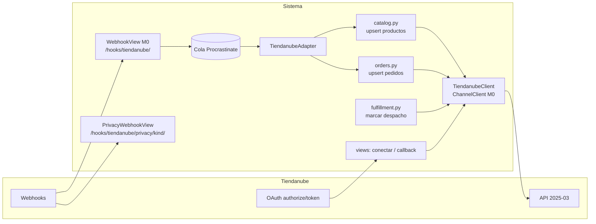
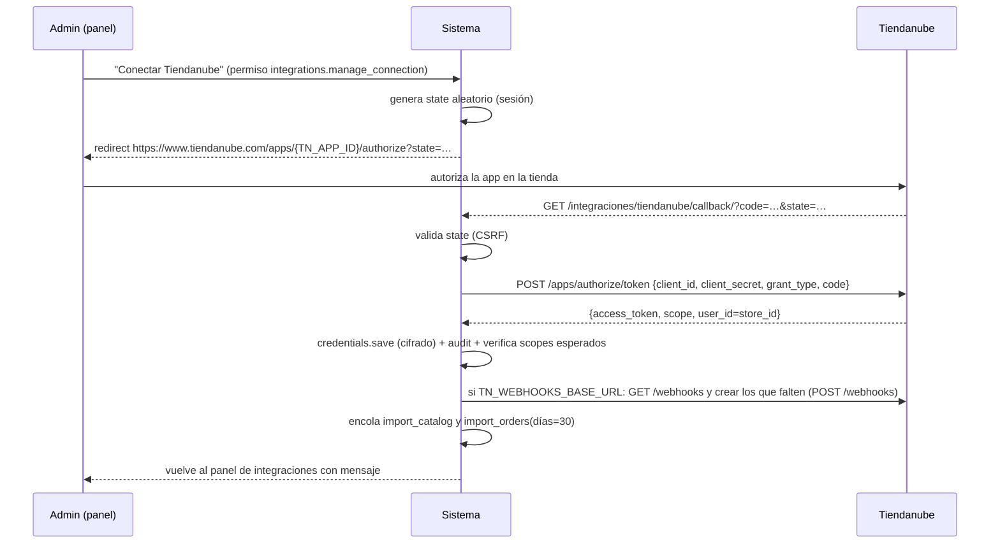

# Design: Integración Tiendanube (módulo M1)

**Status:** Approved (2026-11-14)
**Last updated:** 2026-11-14
**Requirements:** [requirements.md](./requirements.md)

## Overview

Un adaptador `apps/integrations/adapters/tiendanube/` que se enchufa en el framework de M0. No se crea ninguna tabla de pedidos por canal: todo cae en los modelos núcleo (`Product`, `Variant`, `Customer`, `SalesDocument`, …) vinculados por `ExternalRef`. Los webhooks de Tiendanube solo traen `{store_id, event, id}`, así que cada evento significa "volvé a leer la entidad X": el handler consulta la API y hace un *upsert* idempotente. La conciliación periódica usa el mismo upsert, y por eso un evento perdido, repetido o fuera de orden no cambia el resultado.

Referencia de la API: versión `2025-03` (`https://api.tiendanube.com/2025-03/{store_id}`), revisada el 2026-11-14.

## 1. Componentes



```
apps/integrations/adapters/tiendanube/
├── __init__.py        # registra el adaptador en el registry
├── adapter.py         # TiendanubeAdapter: verify_webhook, dedupe_key, topic, handlers, reconcile
├── client.py          # TiendanubeClient: auth, versión, paginación por Link, helpers GET
├── oauth.py           # URL de autorización, canje de código, registro de webhooks
├── catalog.py         # producto TN → Product/Variant/precio/stock
├── orders.py          # pedido TN → Customer/SalesDocument/SalesLine/Payment/Shipment
├── fulfillment.py     # empaquetado / enviado / entregado (fulfillment orders)
├── privacy.py         # store/redact, customers/redact, customers/data_request
├── tasks.py           # importaciones, conciliaciones periódicas, escrituras con reintento
├── views.py           # conectar, callback OAuth, webhooks de privacidad
└── urls.py
```

## 2. Configuración

Variables de entorno, en `.env` y nunca en el repo:

| Variable | Uso |
|---|---|
| `TN_APP_ID` | ID de la app nueva en Partners (URL de autorización) |
| `TN_CLIENT_SECRET` | Canje del código OAuth y verificación HMAC de webhooks |
| `TN_USER_AGENT` | Obligatorio para la API, formato `Sistema Deutsch (email-de-contacto)` |
| `TN_WEBHOOKS_BASE_URL` | URL pública HTTPS del servidor. **Vacía en local:** no se registran webhooks |
| `TN_ORDERS_RECONCILE_MINUTES` | 5 en local (sin webhooks); 15 con servidor |

El token y el `store_id` que devuelve el OAuth se guardan cifrados con `credentials.save("tiendanube", {...})` (M0).

**Permisos (scopes) de la app nueva:** `read_products`, `write_orders`, `read_customers`, `write_fulfillment_orders`. Sin `write_products`: la regla de oro también queda garantizada por los permisos.

## 3. Conexión (US-1)



- **URL de redirección de la app:** en local `http://localhost:8000/integraciones/tiendanube/callback/` (la migración ya usó un callback local); en producción `https://panel.deutsch.com.ar/…`.
- **Webhooks que se registran:**
  - `order/created`, `order/updated`, `order/paid`, `order/packed`, `order/fulfilled`, `order/cancelled`, `order/edited`, `order/voided`;
  - `product/created`, `product/updated`, `product/deleted`;
  - `app/uninstalled`.

  La URL es `{TN_WEBHOOKS_BASE_URL}/hooks/tiendanube/`. El registro es idempotente: compara con `GET /webhooks` y solo crea los que faltan. Hay un comando `manage.py tn_register_webhooks` para correrlo al desplegar.
- **Webhooks de privacidad:** se configuran a mano en el portal de Partners, apuntando a `/hooks/tiendanube/privacy/store_redact/`, `…/customers_redact/` y `…/customers_data_request/`.
- **Si faltan scopes:** si el `scope` devuelto no incluye los esperados, se guarda igual y se avisa al admin. Si incluye `write_products`, aparece la advertencia "la app tiene más permisos de los necesarios".
- **`app/uninstalled`:** borra la credencial, audita y emite la alerta `integration.disconnected` a Administrador. La tarjeta del panel pasa a "Desconectado".

## 4. Verificación y deduplicación de webhooks

- **HMAC:** `hmac.new(TN_CLIENT_SECRET, raw_body, sha256).hexdigest()` comparado con `compare_digest` contra el header `x-linkedstore-hmac-sha256`. La doc muestra hex; si en la prueba real resulta base64, se aceptan los dos formatos.
- **Tiempo de respuesta:** Tiendanube espera respuesta en 3 s. La vista de M0 solo guarda y encola, así que cumple.
- **Clave de deduplicación:** el cuerpo no trae versión ni fecha, así que dos `order/updated` legítimos del mismo pedido son idénticos. La clave es `f"{event}:{id}:{minuto UTC}"`:
  - los reintentos y ráfagas de un mismo minuto colapsan en un evento;
  - un cambio posterior entra como evento nuevo;
  - un duplicado que cruce de minuto solo provoca una relectura, que no hace daño porque el upsert es idempotente.
- **Orden y frescura:** el upsert de pedidos compara el `updated_at` de Tiendanube con el guardado en `ExternalRef.extra["updated_at"]`. Si no es más nuevo, no reescribe nada. Así un evento viejo que llega tarde no pisa datos nuevos.

## 5. Catálogo (US-2)

### Mapeo

| Tiendanube | Sistema |
|---|---|
| product `id` | `ExternalRef(channel=tiendanube, Product)` con `extra={handle, updated_at, visibility}` |
| `name.es`, `description.es` | `Product.name`, `Product.description` |
| `brand`, `categories[].name.es` | `Product.brand`, `Product.categories` (**nuevo** campo JSON, lista de nombres) |
| `images[]` | `Product.images` (**nuevo** campo JSON, `[{url, position, alt}]`) |
| `visibility` / `published` | `Product.is_active` (`hidden` → inactivo) |
| variant `id` | `ExternalRef(channel=tiendanube, Variant)` con `extra={stock, price, promotional_price, updated_at}` |
| `sku`, `barcode` | `Variant.sku` (si viene vacío: `TN-{variant_id}` y marca `needs_review`), `Variant.barcode` (si choca con otra variante, se guarda vacío y se marca) |
| `values[]` + `attributes[]` del producto | `Variant.attributes` (`{"Talle": "M", "Color": "Negro"}`) |
| `weight` (kg), `width/height/depth` (cm) | `weight_g`, `width_mm/height_mm/length_mm` (convertidos) |
| `price`, `promotional_price` | `PriceListItem` de MINORISTA con `pricing.set_price` (solo si cambió) + **nuevo** campo `promotional_price` (nulo) |
| `stock` | ver "Stock" abajo |

**Cambios de modelo** (migración):
- `Product.categories`, `Product.images` (JSON, default lista);
- `Variant.needs_review` (bool) y `Variant.review_notes`;
- `PriceListItem.promotional_price` (nulo).

### Stock
La fuente de verdad del stock es Contabilium, que hoy lo replica en Tiendanube. Mientras no exista la integración directa con Contabilium (M8), **Tiendanube es el canal que alimenta el stock del sistema**:
- el ajuste entra con `inventory.apply_sync_level(..., source=contabilium_sync, note="vía Tiendanube")`;
- el canal que alimenta el stock se configura con `STOCK_FEED_CHANNEL=tiendanube` (setting);
- cada canal guarda además su propio stock en `ExternalRef.extra["stock"]`, que es lo que M3-02 compara entre canales;
- una variante con `stock: null` (sin control de stock en Tiendanube) no genera movimiento.

### Flujos
- **Importación inicial:** tarea `tn_import_catalog`.
  - Recorre `GET /products?per_page=200&page=N` siguiendo el header `Link` hasta el final. Con ~282 productos son 2 pedidos y entran holgados en el límite de 40/2 por segundo.
  - Cada producto se procesa en su propia transacción, así un producto con error no frena al resto: se registra en `SyncRun.stats.errors`.
- **Webhook `product/created|updated`:** `GET /products/{id}` y upsert.
- **Webhook `product/deleted`:** el producto y sus variantes quedan inactivos; nunca se borra nada.
- **Conciliación diaria (03:30):**
  - `GET /products?updated_at_min=…` para los cambios;
  - recorrido completo de IDs una vez al día, que detecta los borrados que no llegaron por webhook: lo que no aparece queda inactivo.

### Regla de oro
El adaptador implementa `write_stock()` y `write_price()` contra `PATCH /products/stock-price`. La primera línea de cada una es `ensure_write_allowed("tiendanube", …)`. Además la app no tiene `write_products`, así que la llamada fallaría igual: doble seguro.

## 6. Pedidos (US-3)

### Mapeo

| Tiendanube | Sistema |
|---|---|
| order `id` | `ExternalRef(channel=tiendanube, SalesDocument)` con `extra={number, updated_at, token}` |
| `number` | se muestra como "TN #1234" (`SalesDocument.notes` no; va en `ExternalRef.extra.number`) |
| `created_at` | `issued_at` |
| `status / payment_status / shipping_status` | `channel_status = "open/paid/unpacked"` (texto crudo) |
| `customer` + `contact_*` + `billing_*` | `Customer(kind=retail)`, ver "Clientes" abajo |
| `shipping_address` | `Address(kind=shipping)` del cliente; snapshot completo en `Shipment` (**nuevo** campo `address` JSON) |
| `products[]` | `SalesLine`: `variant` por `ExternalRef` de la variante o, si no está, por SKU; `sku_snapshot`, `description_snapshot` (name + variant_values), `quantity`, `unit_price=price` |
| `subtotal`, `discount`, `shipping_cost_customer`, `total` | `subtotal`, `discount_total`, `shipping_total`, `total` |
| `gateway`, `payment_status`, `paid_at` | `Payment(method=mercadopago` si el gateway es MP; `transfer`, `cash` u `other` según `gateway`; `status`: paid→confirmed, pending/authorized→pending, refunded/voided→refunded/rejected) |
| `shipping_pickup_type`, `shipping_option`, `shipping_option_code`, `shipping_tracking_*` | `Shipment(method=pickup` si `pickup`; `envio_nube` si el código o la opción son de Envío Nube; si no, `carrier` con `carrier_name=shipping_option)` |
| `cancelled_at`, `cancel_reason` | `channel_status` refleja `cancelled`. El estado interno lo maneja M4 |

- **Clientes:** se busca primero por `ExternalRef(tiendanube, Customer, customer.id)`, después por email y si no se crea. Se guardan `legal_name`, `email`, `phone`, `tax_id` (`contact_identification`; tipo CUIT si tiene 11 dígitos, si no DNI) y la condición de IVA `CF`. No se pisan datos que un usuario haya cargado a mano: solo se completan los vacíos.
- **Upsert:** las líneas, pagos y envíos del pedido se reemplazan por la versión de Tiendanube. Cada pedido se procesa dentro de una transacción. El `status` interno del documento **no** se toca en una actualización (es de M4); solo se pone `new` al crear.
- **SKU desconocido:** la línea se guarda con `variant=None` y se emite la alerta `catalog.unknown_sku` (nueva, para Administrador y Ventas) con `dedupe_key=sku`.
- **Conciliación:**
  - tarea periódica cada `TN_ORDERS_RECONCILE_MINUTES`;
  - `GET /orders?updated_at_min={última OK − 10 min}&per_page=200` siguiendo `Link`;
  - pasa por el mismo upsert y registra un `SyncRun(job="orders")`.
- **Importación inicial:** al conectar, `GET /orders?created_at_min={hoy − 30 días}`.

## 7. Despacho en Tiendanube (US-4)

Tiendanube 2025-03 maneja el despacho con **fulfillment orders**. Los campos viejos `shipping_tracking_*` del pedido equivalen a `fulfillment_order.tracking_info`.

```python
# apps/integrations/adapters/tiendanube/fulfillment.py  — usado por M5
def mark_packed(document, *, actor) -> None
def mark_dispatched(document, *, actor, tracking_code: str = "", tracking_url: str = "") -> None
def mark_delivered(document, *, actor) -> None   # retiro en local o entrega
```

- Cada función **encola** la tarea `tn_fulfillment_update(document_id, action, …)` y vuelve enseguida. La pantalla de despacho no espera a Tiendanube.
- **La tarea:**
  1. `GET /orders/{id}/fulfillment-orders`;
  2. por cada fulfillment order que no esté ya en el estado pedido: `PATCH …/fulfillment-orders/{fo_id}` con el `status` (`PACKED`, `DISPATCHED`) y el `tracking_info {code, url}`; para la entrega, `POST …/tracking-events` con `status: delivered`;
  3. guarda el estado nuevo en `ExternalRef.extra.fulfillment_status`;
  4. audita `order.status_changed` con el `before` y el `after` de Tiendanube.
- **Si ya está en ese estado:** no se hace nada y no se audita (US-4).
- **Errores:** si Tiendanube rechaza o no responde, la tarea se reintenta con espera creciente (1 min, 5 min, 25 min, 2 h, 6 h). Si se agotan los reintentos, emite la alerta `integration.write_failed` (nueva) con el pedido y el error.
- **Validación con el pedido real:** las transiciones válidas dependen del tipo de envío (`pickup` o `ship`). La primera prueba real se hace sobre un pedido de prueba creado en la tienda, nunca sobre un pedido de cliente sin su autorización.
- **No toca stock ni precios:** solo se usan los endpoints de fulfillment orders, que no los modifican.

## 8. Privacidad (US-1)

- **`customers/redact`:** se busca el `Customer` por `ExternalRef` o por email. Se anonimiza: `legal_name="Cliente anonimizado"`; email, teléfono y documento vacíos; domicilios borrados; dirección del `Shipment` vaciada. Los documentos de venta se conservan (totales y líneas) porque son registros comerciales. Se audita con la acción nueva `privacy.customer_redacted`.
- **`store/redact`:** anonimiza todos los clientes vinculados a Tiendanube y borra la credencial.
- **`customers/data_request`:** emite la alerta `privacy.data_request` a Administrador con el cliente pedido, para responder a mano. No se exportan datos de forma automática.
- **Firma:** las tres vistas verifican el HMAC y responden 200 enseguida. El trabajo se encola.

## 9. Spike Envío Nube (US-5)

Según la documentación, las etiquetas (`/fulfillment-orders/labels`) requieren la funcionalidad `fulfillment_order_label_api`, que sería solo del plan Next de Tiendanube. El spike:
1. `GET /store` para ver si la tienda tiene esa funcionalidad;
2. `GET /orders/{id}/fulfillment-orders` sobre un pedido real con Envío Nube, para ver si trae `labels`, el código de seguimiento y su estado;
3. documenta el resultado en `docs/spikes/envio-nube.md`. Si las etiquetas no están disponibles, el plan B es un link `https://{tienda}.mitiendanube.com/admin/orders/{id}` que abre el pedido en el admin para imprimir.

Todo con GET: el spike no escribe nada.

## 10. Panel

Tarjeta de Tiendanube en Integraciones:
- botón **Conectar / Reconectar** (permiso nuevo `integrations.manage_connection`, solo Administrador);
- tienda conectada, scopes, si los webhooks están registrados o en modo "consulta cada 5 min";
- botones **Importar catálogo** e **Importar pedidos (30 días)** (permiso `integrations.retry_event`).

## 11. Cambios en M0 (chicos)

- `services.run_reconciliation(channel, job, fn=None)`: acepta un `fn(since)` para que un canal tenga varias conciliaciones (`orders` cada 5 min y `catalog` diaria). Sin `fn`, usa `adapter.reconcile` como hasta ahora.
- **Alertas nuevas** (migración de datos): `catalog.unknown_sku`, `integration.write_failed`, `integration.disconnected`, `privacy.data_request`.
- **Acciones de auditoría nuevas:** `integration.connected`, `privacy.customer_redacted`.
- Permiso `integrations.manage_connection` (rol Administrador).

## 12. Trade-offs

| Decisión | Elegido | Alternativa | Por qué |
|---|---|---|---|
| Qué hace un webhook | Relee la entidad por API y hace upsert | Usar el cuerpo del webhook | El cuerpo de TN solo trae el `id`; releer además hace todo idempotente y tolerante al desorden |
| Clave de dedupe | `evento:id:minuto` | `evento:id` | Con `evento:id` se perderían actualizaciones legítimas posteriores del mismo pedido |
| Despacho | API de fulfillment orders | Campos viejos del pedido | Es la API vigente (2025-03) y la única con estados de empaquetado y entrega |
| Stock | TN alimenta el stock hasta M8 | Esperar a Contabilium | El stock de TN ya es el de Contabilium replicado; esperar dejaría M4/M5 sin stock |
| Scopes | Sin `write_products` | Reusar la app de migración | La regla de oro queda garantizada también por permisos |
| Sin servidor | Conciliación cada 5 min | Túnel permanente | Decidido por el usuario; los webhooks se activan solos al configurar `TN_WEBHOOKS_BASE_URL` |

## 13. Tests

- La API de Tiendanube se simula con `respx` y JSON de ejemplo en `tests/fixtures/tiendanube/` (producto con variantes, pedido pagado con Envío Nube, pedido de retiro, pedido cancelado, fulfillment orders). Ningún test llama a la API real.
- **Casos:**
  - firma válida e inválida (hex y base64);
  - dedupe por minuto;
  - upsert idempotente: mismo pedido dos veces → un documento;
  - evento viejo que no pisa uno nuevo;
  - SKU desconocido → alerta;
  - paginación por `Link`;
  - un producto con error no frena la importación;
  - producto borrado → inactivo;
  - stock → movimiento solo si cambió;
  - fulfillment: transición, ya en estado (no hace nada), error → reintentos → alerta;
  - privacidad: anonimización;
  - `app/uninstalled`;
  - OAuth: state inválido rechazado y canje OK con credencial cifrada;
  - `write_stock` bloqueado.
- **Prueba manual real:** después de que crees la app, conexión con la tienda 8434848, importación de catálogo y de los pedidos de 30 días, y spike de Envío Nube. Todo en lectura, salvo el despacho sobre un pedido de prueba.

## 14. Trazabilidad

| Requirement | Dónde |
|---|---|
| US-1 permisos mínimos, OAuth, token cifrado, webhooks sin duplicar, desinstalación, privacidad, HMAC | §2, §3, §4, §8 |
| US-2 importación completa, ExternalRef sin duplicar, webhooks, conciliación diaria, stock y precio sin escribir en TN, SKU vacío | §5 |
| US-3 eventos, datos completos, sin duplicados, conciliación, SKU desconocido, 30 días, channel_status | §4, §6 |
| US-4 empaquetado, enviado y entregado, reintentos y alerta, sin tocar stock, auditoría, ya en estado | §7 |
| US-5 spike documentado y plan B | §9 |

## Riesgos

- **Transiciones de fulfillment:** las reglas dependen del tipo de envío y la doc no se pudo leer completa. Se validan en la prueba real con un pedido de prueba.
- **Envío Nube en la API:** las etiquetas pueden no estar disponibles en el plan de la tienda. El plan B ya está definido.
- **Formato del HMAC (hex o base64):** se aceptan los dos hasta confirmarlo con un webhook real.
